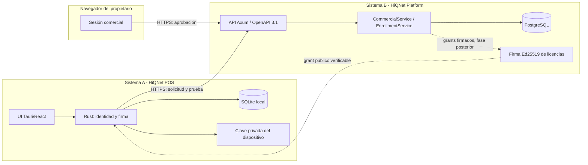

# ADR-0003 — Identidad de instalaciones y enrolamiento seguro POS ↔ Platform

- **Propósito:** definir la identidad criptográfica de una instalación y el protocolo propuesto para vincularla a una organización comercial.
- **Estado:** PROPOSED — pendiente de aprobación del titular.
- **Fecha:** 2026-11-08.
- **Alcance:** diseño documental G4.2-A. No implementa endpoints, migraciones ni cambios en el POS.
- **Decisiones:** alternativas y recomendaciones en §6; pendientes en §12.
- **Riesgos:** §11.
- **Referencias:** §15.
- **Baseline Platform:** `f8823ad07fcd63dd5b5a17dd4cb11612736f2a22`.
- **Baseline POS:** `b3def1efb2863caf08fd525bac4e78db3ba223f7` (solo lectura).
- **Dependencias:** aprobación del titular; ADR-0001/0002; ADR-004 del POS; contratos OpenAPI vigentes. Los documentos rectores 00C y 08-01/08-02/08-03 no están disponibles en el workspace local.

## 1. Contexto

HiQNet tiene dos sistemas con autoridades distintas:

- **HiQNet POS** (Sistema A): aplicación local Rust + React + Tauri 2 + SQLite. Debe seguir vendiendo sin Internet durante operaciones autorizadas. La autorización comercial se verifica en Rust con grants Ed25519 y estado persistido en `local_installation_state`.
- **HiQNet Platform** (Sistema B): backend Axum + PostgreSQL + OpenAPI 3.1. Es autoridad sobre cuentas comerciales, organizaciones, membresías, instalaciones, Trial, licencias, renovaciones y auditoría.

Hoy existen:

- Identidad comercial con credenciales Argon2id y sesiones PostgreSQL (P02.2).
- Organizaciones y membresías RBAC `owner`/`admin`/`member` con aislamiento SQL (P02.3).
- Auditoría comercial append-only.
- Gestión **técnica** de instalaciones y emisión **técnica** de licencias firmadas desde rutas DEV.
- En el POS: bootstrap local que crea un Trial de 30 días, identidad de instalación UUID local, verificación Ed25519 del `LicenseGrant` y política de solo lectura al vencer.

Nada de lo anterior constituye todavía un protocolo productivo de vinculación. En particular:

- Registrar una instalación exige el token administrativo DEV, no una sesión comercial.
- El endpoint DEV acepta cualquier `organization_id` preexistente y no comprueba membresía.
- Un UUID de instalación o una etiqueta de dispositivo no prueban posesión.
- Un `installation_id` nuevo obtiene una ventana de Trial nueva.
- No hay historial de rehost, rotación de identidad ni eventos de seguridad de enrolamiento.

## 2. Problema

Falta un protocolo que garantice simultáneamente:

1. Identidad comercial autenticada.
2. Autoridad del actor sobre la organización.
3. Posesión de la identidad criptográfica de la instalación.
4. Vinculación persistente al tenant correcto.
5. Idempotencia y protección frente a duplicados.
6. Auditoría de enrolamiento y rehost.
7. Elegibilidad central del Trial.
8. Prevención razonable de reinicio fraudulento del Trial.
9. Continuidad offline con autorización válida.
10. Separación entre enrolamiento, elegibilidad/Trial y licenciamiento.

## 3. Objetivos

- Diseñar un enrolamiento verificable, idempotente y auditable.
- Mantener el POS operativo offline después de la autorización.
- No confundir identidad de dispositivo con identidad comercial ni con la clave de emisión de licencias.
- Definir invariantes aplicables en PostgreSQL.
- Preparar migraciones incrementales y PRs independientes sin implementarlos.

## 4. No objetivos (G4.2-A)

- Implementar endpoints, DDL o cambios en `hiqnet-pos`.
- Cobros, facturación, cloud sync, portal React, límites por plan, leases o periodos de gracia.
- Garantizar unicidad física del dispositivo o resistencia absoluta a un administrador que controla el equipo.

## 5. Restricciones

- No modificar migraciones publicadas (`0001`–`0003` en Platform; `0001`–`0011` en POS).
- El token DEV no es credencial comercial ni de activación.
- La clave privada de emisión de licencias permanece exclusivamente en Platform.
- La identidad de instalación no puede basarse en `device_label` ni en un UUID enviado por el cliente como autoridad.
- Un dispositivo completamente offline y controlado por el usuario impide garantías absolutas de reloj, clonación o revocación diferida.
- No inventar límites de dispositivos, reinstalaciones, gracia o cuotas.
- Sin plan gratuito permanente: Trial 30 días; Local/Pro/Enterprise de pago.

## 6. Alternativas evaluadas

### 6.1 Decisión A — Quién puede enrolar

| Criterio | A: solo `owner` | B: `owner` + `admin` | C: permiso específico |
|---|---|---|---|
| Superficie de privilegio | Mínima | Media | Baja, pero requiere modelo nuevo |
| Operación multisucursal | Depende del propietario | Delegable | Delegable y granular |
| Complejidad inicial | Baja | Baja | Alta (nuevo permiso, migración, UI) |
| Impacto de cuenta admin comprometida | Nulo para enrolar | Alto | Acotado al permiso |
| Coherencia con RBAC actual | Alta | Alta | Requiere extender RBAC |
| Recomendación | **Sí, para G4.2-B** | Evaluar después | No ahora (prematuro) |

**Recomendación:** `owner` exclusivamente en la primera implementación. No se modifica RBAC en G4.2-A. El modelo de datos se diseña para admitir un futuro permiso `installation.manage` sin rehacer tablas.

### 6.2 Decisión B — Identidad criptográfica de la instalación

| Alternativa | Seguridad | Complejidad | Portabilidad | Reinstalación / recuperación | Replay | Offline | Veredicto |
|---|---|---|---|---|---|---|---|
| 1. UUID cliente | Nula como prueba | Mínima | Total | Trivial de falsear | N/A | Sí | Rechazada como identidad |
| 2. Token de un solo uso | Media (secreto bearer) | Baja | Total | Se pierde con el equipo | Riesgo si se filtra | Solo enrolamiento | Insuficiente sola |
| 3. Par de claves local | Alta para posesión de clave | Media | Windows/Linux/Android | Requiere custodia/recuperación | Firmas con nonce | Sí | **Base recomendada** |
| 4. Challenge-response | Alta | Media | Total | Igual que 3 | Resistente | Solo enrolamiento | **Parte de la base** |
| 5. Token + par de claves | Alta | Media | Total | Recuperación vía owner | Resistente | Sí | **Recomendada** |
| 6. TPM/Keystore obligatorio | Muy alta | Alta | Excluye equipos sin TPM | Compleja | Resistente | Sí | Opcional, no universal |
| 7. Recuperación sin hardware seguro | Media | Media | Total | Rehost auditado | N/A | Sí | Necesaria como fallback |

**Recomendación:** identidad de dispositivo = **par de claves Ed25519 generado localmente**, con clave privada protegida por el almacén del SO cuando exista (DPAPI, Keychain, libsecret, Android Keystore) y archivo con permisos restrictivos como fallback. El servidor guarda solo la clave pública y su huella. La prueba de posesión es una firma sobre un nonce de servidor, de un solo uso. TPM/Keystore fuerte es mejora opcional, nunca requisito universal.

Criterios adicionales de la comparación:

| Criterio | UUID | Token 1 uso | Clave local | Challenge | Token+clave | TPM | Recuperación |
|---|---|---|---|---|---|---|---|
| Dependencias | Ninguna | Servidor + TTL | `ed25519-dalek`, keystore | Clave + nonce | Ambas | SDK/TPM | Flujo admin |
| Coste operativo | Nulo | Bajo | Bajo | Bajo | Bajo | Alto | Medio |
| Copia de claves | No aplica | Se copia el token | Copia de perfil posible | Igual | Igual | Ligada al hardware | Exportación controlada |
| Rotación | Trivial | Emitir otro | Re-enrolar | Re-enrolar | Re-enrolar | Compleja | Rehost |
| Experiencia de usuario | Mínima | Código | Transparente tras alta | Transparente | Código + transparente | Requiere hardware | Soporte |
| Riesgo de pérdida | Nulo | Token perdido | Clave perdida | Igual | Igual | Equipo perdido | Recuperable |

No se usa la misma clave para identidad de dispositivo y para firmar licencias. La clave de emisión sigue siendo exclusiva de Platform.

### 6.3 Alternativas de flujo

- **Portal web completo con sesión embebida en el POS:** descartado para G4.2-B; el portal React está fuera de alcance y aumenta superficie.
- **Credenciales comerciales dentro del POS:** descartado; convierte al POS en custodio de contraseñas y amplía el daño de un equipo comprometido.
- **Enrolamiento con solo `installation_id`:** descartado; no prueba posesión.
- **Device-code + prueba de clave (recomendado):** el POS inicia, el propietario aprueba en navegador, el POS demuestra posesión y completa. Funciona en Windows/Linux/Android sin deep links obligatorios.

## 7. Arquitectura recomendada

### 7.1 Componentes

### 7.2 Flujo propuesto

1. El POS genera (o recupera) su par de claves Ed25519 y conserva `installation_id` local.
2. `POST /enrollment-requests` (público, rate-limited): envía `installation_id`, clave pública, etiqueta, versión y plataforma; recibe `user_code`, `device_code`, `verification_uri`, `nonce` y expiración corta.
3. El propietario abre `verification_uri`, inicia sesión comercial, elige organización y aprueba el `user_code`.
4. `POST /enrollment-requests/{device_code}/proof` (público, rate-limited): el POS firma el `nonce` con su clave privada. Platform verifica firma, estado `approved`, expiración y consumo único.
5. En una transacción: se consume el challenge, se crea/valida la instalación, se registra la vinculación y se audita `installation_enrolled`.
6. La instalación queda vinculada. **No** se activa Trial ni se emite licencia en esta operación.
7. La activación de Trial es una operación posterior e independiente (G4.2-C).
8. La emisión de grants firmados es otra operación posterior (licenciamiento).

### 7.3 Justificación del flujo

- Separa el canal autenticado (navegador) del canal de dispositivo (POS), evitando credenciales comerciales en el POS.
- La aprobación humana enlaza organización y actor con la solicitud.
- La firma del nonce demuestra posesión de la clave privada sin transmitirla.
- El código de usuario evita exigir deep links en Android/escritorio.
- La prueba se consume una sola vez y expira.

### 7.4 Modelo de confianza

- El navegador autentica **persona y organización**.
- El POS demuestra **posesión de clave**.
- Platform decide **elegibilidad y autorización**.
- PostgreSQL conserva **estado y auditoría**.
- Ningún canal aislado concede acceso por sí solo.

### 7.5 Revalidación final y orden de bloqueos

La aprobación no es una autorización permanente. Antes de confirmar el binding, `/proof` revalida en la misma transacción:

1. Solicitud `approved`, vigente y no consumida.
2. Nonce válido y firma Ed25519 correcta.
3. Organización `active`.
4. Cuenta aprobadora `active`.
5. Membresía activa del aprobador.
6. Rol `owner` vigente (`role_version = 1`).
7. Instalación sin binding activo en otro tenant.
8. Clave pública sin conflicto con otra identidad activa.
9. Consumo, vinculación y auditoría atómicos.

Orden de bloqueos: `enrollment_request` → `organization` → revalidación de cuenta/membresía → verificación de índices de identidad/binding. Coincide con el orden de P02.3, que bloquea la organización antes de leer la membresía; ninguna ruta bloquea la organización y después la solicitud, por lo que no se introduce un ciclo.

Punto de linearización: la transacción de `/proof` decide después de adquirir los bloqueos y releer la autoridad. Si una revocación se confirmó antes de esa relectura, el binding se rechaza; si `/proof` confirma primero, la revocación posterior no borra el binding histórico, pero las consultas y licencias futuras vuelven a comprobar el estado. El resultado es determinista según el orden de commit.

### 7.6 Clonación: límites reales

Una clave privada copiada produce firmas válidas en ambos equipos. El diseño distingue:

| Escenario | Detección | Límite |
|---|---|---|
| Misma clave, distinto `installation_id` | Índice único de fingerprint activo → 409 + evento. | Prevención efectiva si el segundo intento pasa por Platform. |
| Misma clave, mismo `installation_id` | Criptográficamente indistinguible. | No se promete detección en el enrolamiento. |
| Clonación offline | No observable en tiempo real. | Solo detección diferida por señales al reconectar. |

Mitigaciones proporcionadas: registro de conexiones/renovaciones, `generation` de identidad, secuencias monotónicas cuando sean verificables, anomalías al reconectar, rehost explícito, revocación y TPM opcional. No se exige fingerprinting invasivo ni se promete unicidad física.

| Fase | Acción |
|---|---|
| Prevención | Índice único de clave activa, custodia de clave, TPM opcional, rehost autorizado. |
| Detección | Conflictos de fingerprint, generaciones, conexiones/renovaciones anómalas y revisión. |
| Respuesta | Revocar identidad, cerrar binding, evento `clone_suspected`, soporte. |
| Recuperación | Rehost a la instalación legítima; el Trial consumido no se reinicia. |

## 8. Invariantes de seguridad

| ID | Invariante |
|---|---|
| I-01 | El actor y la organización de una mutación se derivan de la sesión y del recurso, nunca de un UUID enviado por el cliente. |
| I-02 | Un `installation_id` no autoriza nada por sí mismo. |
| I-03 | Toda vinculación exige aprobación de un `owner` activo sobre una organización activa. |
| I-04 | Toda prueba de posesión usa un nonce de servidor, expira y se consume exactamente una vez. |
| I-05 | La clave privada del dispositivo nunca se transmite a Platform. |
| I-06 | Platform almacena solo clave pública, huella y metadatos no secretos. |
| I-07 | Un `installation_id` no puede cambiar de organización por solicitud del cliente. |
| I-08 | Una clave pública activa no puede pertenecer a dos instalaciones activas. |
| I-09 | Las mutaciones de enrolamiento y su auditoría se confirman en la misma transacción. |
| I-10 | Reintentos con la misma `Idempotency-Key` y mismo payload devuelven el resultado previo **no secreto**; distinto payload devuelve 409. |
| I-11 | La elegibilidad del Trial es estatal y persistente; no depende solo de memoria ni del reloj local. |
| I-12 | La clave de emisión de licencias no se usa para identidad de dispositivo ni viceversa. |
| I-13 | Toda respuesta cross-tenant es 404 neutral; el rol insuficiente es 403 solo si el actor ya pertenece al recurso. |
| I-14 | Los eventos de auditoría y seguridad son append-only. |
| I-15 | Las rutas DEV no se reutilizan para flujos comerciales. |
| I-16 | Ningún código de enrolamiento (`device_code`, `user_code`, `nonce`) se persiste en claro ni dentro de una respuesta idempotente; la entrega es única por defecto. |
| I-17 | La confirmación final del binding revalida organización activa, cuenta activa, membresía activa y rol `owner` vigente del aprobador dentro de la misma transacción. |
| I-18 | Una instalación mantiene una sola organización propietaria durante su vida; solo existe un binding activo y el historial se conserva por cierre de vigencia. |

## 9. Consecuencias técnicas

- Nuevas tablas y columnas en migraciones incrementales (`0004+`), sin tocar las publicadas.
- Nuevo servicio de aplicación `EnrollmentService` y repositorio PostgreSQL; el handler permanece delgado.
- La idempotencia del inicio no recupera códigos bearer: el POS reinicia el flujo si pierde la respuesta.
- La transacción de proof revalida la autoridad vigente y serializa con el bloqueo de organización de P02.3.
- El POS necesitará custodia de clave y un comando de enrolamiento en G4.2-D.
- El contrato `LicenseGrant` v1 no cambia en G4.2-A; cualquier cambio exige v2 y compatibilidad.
- La emisión de licencias deberá consultar identidad y elegibilidad antes de firmar.
- La auditoría comercial amplía acciones mediante migración del `CHECK`.
- Aumenta el estado persistido y la superficie de pruebas de concurrencia.

## 10. Consecuencias comerciales

- El Trial queda ligado a organización (recomendación), no a instalaciones recreadas.
- Un cliente legítimo que formatea o cambia de PC necesitará un rehost autorizado y auditable.
- La reclamación masiva de Trials por múltiples cuentas no puede impedirse de forma absoluta; se controla con evidencia y límites operativos aprobados, no inventados.
- El enrolamiento inicial requiere conectividad (decisión pendiente sobre el bootstrap offline).
- No se alteran precios ni derechos de Local/Pro/Enterprise.

## 11. Riesgos residuales

| Riesgo | Residual |
|---|---|
| Usuario con control total del equipo y offline manipula reloj o copia claves | No eliminable; se acota con validez de grants y detección al reconectar. |
| Clonación de clave privada | Se detecta si la clave aparece en otra identidad activa; si comparte `installation_id` o está offline, no se distingue criptográficamente. Se acota con señales al reconectar y revocación. |
| Trials repetidos con cuentas/organizaciones nuevas | Solo mitigable con verificación de identidad y abuso; no hay identificación personal infalible. |
| Compromiso de cuenta `owner` | Permite enrolar y rehost; se mitiga con sesión, CSRF, rate limit y auditoría. |
| Filtración de códigos bearer por persistencia idempotente | Entrega única y prohibición de guardar secretos en `response_body`; reinicio del flujo si se pierden. |
| Restauración de backup antiguo | El POS ya preserva el estado comercial actual; el diseño no debe relajarlo. |
| Revocación diferida en offline | El grant sigue válido hasta `valid_until`; lease/gracia está pendiente. |

## 12. Decisiones pendientes (no aprobadas)

1. `owner` exclusivo vs `owner`+`admin` para enrolar.
2. Autoridad exacta del Trial: organización, cuenta o combinación.
3. Tratamiento de instalaciones con Trial local previo a G4.2-D.
4. Requisito de conectividad para la primera activación.
5. Política de rehost: automática auditada vs revisión manual a partir de umbral.
6. Duración de `valid_until` de grants y política de lease/gracia.
7. Custodia de claves por plataforma (DPAPI/Keychain/libsecret/Keystore/archivo).
8. Verificación de correo o identidad para reducir abuso de Trials.
9. Formato público de `key_id` y rotación de la clave de emisión.
10. Retención de solicitudes, challenges y eventos de seguridad.
11. Recuperación idempotente de secretos de enrolamiento: entrega única (recomendada) vs respuesta cifrada recuperable.
12. Señales de detección de clonación que se adoptarán sin fingerprinting invasivo.

## 13. Criterios de aceptación del diseño

- Existe ADR, threat model, protocolo, modelo de datos, política de Trial/rehost y plan de PRs.
- Las invariantes I-01…I-15 son verificables mediante pruebas descritas.
- El modelo distingue instalación, organización, cuenta, sesión y claves.
- El protocolo resiste replay, duplicados y carreras descritas.
- No se declara ninguna decisión pendiente como aprobada.
- No se modifican migraciones, código funcional ni el repositorio POS.

## 14. Plan de implementación por PR (resumen)

| PR | Alcance | Depende de |
|---|---|---|
| G4.2-B | Migraciones, identidad de instalación, challenges, API de enrolamiento, auditoría y pruebas. | Aprobación de este ADR |
| G4.2-C | Elegibilidad y activación de Trial, idempotencia y concurrencia. | G4.2-B |
| G4.2-D | Integración POS: custodia de clave, protocolo, grants y verificación. | G4.2-C |
| G4.2-E | Endurecimiento, rehost, clonación, rotación, E2E y compatibilidad. | G4.2-D |

Detalle en [Plan de implementación y pruebas G4.2](g42-implementation-plan.md).

## 15. Referencias

- [ADR-0001 — Identidad comercial](adr-0001-commercial-identity.md)
- [ADR-0002 — Autenticación comercial](adr-0002-authentication-strategy.md)
- [Identidad comercial y aislamiento](commercial-identity.md)
- [Diseño de autenticación P02.2](p022-authentication-design.md)
- [API HTTP y OpenAPI](../02-development/api.md)
- [Modelo de amenazas G4.2](g42-enrollment-threat-model.md)
- [Protocolo de enrolamiento G4.2](g42-enrollment-protocol.md)
- [Modelo de datos G4.2](g42-data-model.md)
- [Gestión de claves Ed25519 G4.2](g42-key-management.md)
- [Elegibilidad, rehost y recuperación G4.2](g42-trial-eligibility-rehost-policy.md)
- [Matriz de decisiones G4.2](g42-decisions-matrix.md)
- POS `docs/01-architecture/decisions/ADR-004-licensing.md` (repo externo, solo lectura).
- Documentos rectores 00C y 08-01/08-02/08-03: no disponibles en el workspace local durante G4.2-A; se aplican las decisiones ratificadas en los ADR y documentos de Platform/POS anteriores.
