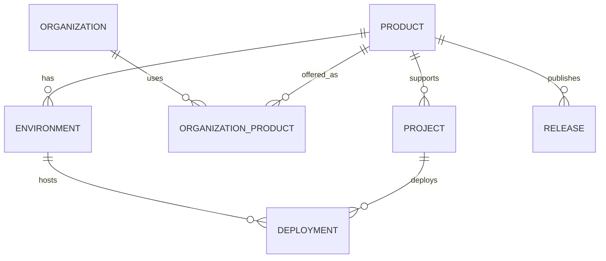

# ADR-0007 — Modelo de Product y Project

**Estado:** ACCEPTED (ratificado 2026-11-09; DDL se crea en C2)
**Fecha:** 2026-11-09
**Fase:** C0 — Architecture Foundation
**Relacionado:** [ADR-0004](adr-0004-control-center-boundaries.md), [ADR-0006](adr-0006-staff-rbac.md)

## 1. Contexto

El Control Center administrará un catálogo creciente de productos. Necesitamos distinguir con precisión qué es un **Product**, qué es un **Project**, y cómo se relacionan con clientes, entornos y despliegues, sin convertir el núcleo en un dashboard exclusivo del POS.

## 2. Definiciones

### Product

Una oferta o aplicación reusable de HiQNet.

Ejemplo: `HiQNet POS`.

| Campo                       | Tipo conceptual     | Notas                                            |
| --------------------------- | ------------------- | ------------------------------------------------ |
| `id`                        | UUID                | Identidad técnica                                |
| `key`                       | TEXT único, estable | Ej. `pos`; nunca cambia; no es el nombre visible |
| `name`                      | TEXT                | Nombre visible                                   |
| `description`               | TEXT                | Descripción                                      |
| `status`                    | enum                | `development                                     | active | maintenance | deprecated | retired` |
| `product_type`              | enum                | `desktop                                         | saas   | web         | mobile     | service  | integration | internal` |
| `created_at` / `updated_at` | TIMESTAMPTZ         |                                                  |

### Product capabilities (módulos)

Cada producto declara capacidades que el Control Center renderiza como módulos:

```
pos → organizations, installations, licenses, trial, subscriptions, sync
```

No se hardcodea el sidebar alrededor de POS.

### Project

Una unidad operativa o técnica gestionada dentro de HiQNet. **No** es una organización cliente.

Ejemplos: `platform-api`, `platform-portal`, `control-center`, `pos-desktop`, una integración, un servicio.

| Campo                       | Tipo conceptual                                                   |
| --------------------------- | ----------------------------------------------------------------- |
| `id`                        | UUID                                                              |
| `key`                       | TEXT único                                                        |
| `name`                      | TEXT                                                              |
| `description`               | TEXT                                                              |
| `project_type`              | enum (`service                                                    | application | integration | infrastructure | initiative`) |
| `product_id`                | UUID nullable (un proyecto puede soportar uno o varios productos) |
| `status`                    | enum                                                              |
| `created_at` / `updated_at` | TIMESTAMPTZ                                                       |

### Environment

`development | staging | production`. Pertenece a un producto y/o proyecto.

### Deployment

Representación de un despliegue (futuro): `deployment_id`, `project_id`, `environment_id`, `version`, `status`, `provider`, `deployed_at`.

### Release

Agrupación lógica producto/versión/canal/entorno. No se sincroniza automáticamente con Git tags en esta fase.

### Organization ↔ Product

Relación `organization_product`:

| Campo             | Tipo conceptual                            |
| ----------------- | ------------------------------------------ |
| `organization_id` | UUID                                       |
| `product_id`      | UUID                                       |
| `status`          | enum                                       |
| `activated_at`    | TIMESTAMPTZ                                |
| `entitlements`    | estructura extensible (no pricing todavía) |

No se implementa pricing/billing en esta fase.

## 3. ER conceptual



## 4. Principios de modelado

- Invariantes en columnas y constraints relacionales; JSONB sólo para metadata realmente extensible (ej. `entitlements`).
- `key` estable e inmutable; el nombre visible puede cambiar.
- Tenant isolation intacta: `organization_product` conserva `organization_id` y FKs.
- Permisos (qué puede hacer un actor) ≠ entitlements (qué capacidad comercial tiene una organización).

## 5. Ciclo de vida y autoridad

- `create/activate/deprecate/retire` de producto: `platform_admin` o superior, auditado.
- `retired` no se borra; se conserva para trazabilidad.
- No hay borrado físico de productos con historial.

## 6. Decisiones ratificadas

- **`product_type`:** `desktop | saas | web | mobile | service | integration | internal`; **`status`:** `development | active | maintenance | deprecated | retired`.
- **`Project`:** independiente, con `product_id` opcional (puede soportar uno o varios productos).
- **`entitlements`:** estructura extensible (JSONB) sin pricing; invariantes relacionales en columnas.
- **DDL:** se implementa en C2 (`0006_product_project.sql`) tras esta ratificación; no se creó en C0.

## 7. No objetivos de esta fase

- Pricing, billing, pagos.
- Sincronización automática con Git/GitHub.
- Catálogo de proveedores cloud.
- Métricas de salud inventadas.
