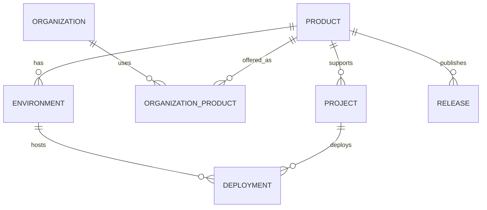

# ADR-0007 — Modelo de Product y Project

**Estado:** ACCEPTED (ratificado 2026-11-09; DDL se crea en C2)
**Fecha:** 2026-11-09
**Fase:** C0 — Architecture Foundation
**Relacionado:** [ADR-0004](adr-0004-control-center-boundaries.md), [ADR-0006](adr-0006-staff-rbac.md)

## 1. Contexto

El Control Center administrará un catálogo creciente de productos. Necesitamos distinguir con precisión qué es un **Product**, qué es un **Project**, y cómo se relacionan con clientes, entornos y despliegues, sin convertir el núcleo en un dashboard exclusivo del POS.

## 2. Definiciones

### Product

Una oferta o aplicación reusable de HiQNet.

Ejemplo: `HiQNet POS`.

| Campo                       | Tipo conceptual     | Notas                                            |
| --------------------------- | ------------------- | ------------------------------------------------ |
| `id`                        | UUID                | Identidad técnica                                |
| `key`                       | TEXT único, estable | Ej. `pos`; nunca cambia; no es el nombre visible |
| `name`                      | TEXT                | Nombre visible                                   |
| `description`               | TEXT                | Descripción                                      |
| `status`                    | enum                | `development                                     | active | maintenance | deprecated | retired` |
| `product_type`              | enum                | `desktop                                         | saas   | web         | mobile     | service  | integration | internal` |
| `created_at` / `updated_at` | TIMESTAMPTZ         |                                                  |

### Product capabilities (módulos)

Cada producto declara capacidades que el Control Center renderiza como módulos:

```
pos → organizations, installations, licenses, trial, subscriptions, sync
```

No se hardcodea el sidebar alrededor de POS.

### Project

Una unidad operativa o técnica gestionada dentro de HiQNet. **No** es una organización cliente.

Ejemplos: `platform-api`, `platform-portal`, `control-center`, `pos-desktop`, una integración, un servicio.

| Campo                       | Tipo conceptual                                                   |
| --------------------------- | ----------------------------------------------------------------- |
| `id`                        | UUID                                                              |
| `key`                       | TEXT único                                                        |
| `name`                      | TEXT                                                              |
| `description`               | TEXT                                                              |
| `project_type`              | enum (`service                                                    | application | integration | infrastructure | initiative`) |
| `product_id` | UUID nullable — **0..1 producto**; un producto puede tener varios proyectos |
| `status`                    | enum                                                              |
| `created_at` / `updated_at` | TIMESTAMPTZ                                                       |

### Environment

`development | staging | production`. Pertenece a un producto y/o proyecto.

### Deployment

Representación de un despliegue (futuro): `deployment_id`, `project_id`, `environment_id`, `version`, `status`, `provider`, `deployed_at`.

### Release

Agrupación lógica producto/versión/canal/entorno. No se sincroniza automáticamente con Git tags en esta fase.

### Organization ↔ Product

Relación `organization_product`:

| Campo             | Tipo conceptual                            |
| ----------------- | ------------------------------------------ |
| `organization_id` | UUID                                       |
| `product_id`      | UUID                                       |
| `status`          | enum                                       |
| `activated_at`    | TIMESTAMPTZ                                |
| `entitlements`    | estructura extensible (no pricing todavía) |

No se implementa pricing/billing en esta fase.

## 3. ER conceptual



## 4. Principios de modelado

- Invariantes en columnas y constraints relacionales; JSONB sólo para metadata realmente extensible (ej. `entitlements`).
- `key` estable e inmutable; el nombre visible puede cambiar.
- `product_type`, `project_type` y la asociación Proyecto → Producto son **inmutables** en el registro (C2). Cambiarlos requiere un proceso administrativo futuro, no un PATCH.
- `Project` pertenece a **cero o un** `Product`; un `Product` puede agrupar varios `Project`. Si en el futuro un proyecto debe servir a varios productos, se introducirá una tabla `project_product`, no una FK múltiple.
- Tenant isolation intacta: `organization_product` conserva `organization_id` y FKs.
- Permisos (qué puede hacer un actor) ≠ entitlements (qué capacidad comercial tiene una organización).

## 5. Ciclo de vida y autoridad

- `create/activate/deprecate/retire` de producto: `platform_admin` o superior, auditado.
- `retired` no se borra; se conserva para trazabilidad.
- No hay borrado físico de productos con historial.

## 6. Decisiones ratificadas

### C4.0 — `organization_product` (IMPLEMENTADO / VALIDADO en C4)

Integrado en `main` mediante la migración `0008` (squash `00a6baa`, 2026-11-09) y validado con PostgreSQL 17 real.

- **Relación persistente:** una fila por `(organization_id, product_id)`; no se elimina físicamente. La desactivación y reactivación reutilizan la misma fila.
- **`status`:** sólo `active | inactive`. No representa Trial, licencias, suscripciones, cobro, expiración ni estado de pago.
- **`activated_at`:** timestamp obligatorio e inmutable de la primera activación; no cambia al reactivar. Un futuro `status_changed_at` o historial se añadirá explícitamente, sin sobrecargar este campo.
- **`entitlements`:** objeto JSONB extensible con `{}` por defecto. En C4 no se interpreta como autoridad de negocio ni contiene pricing, planes, límites licenciados, Trial o billing.
- **Independencia de ejes:** `organization.status` y `organization_product.status` no se propagan ni se derivan entre sí.
- **C4 read-only:** la migración permitirá que `status` y `entitlements` evolucionen en fases posteriores, pero C4 no publica mutaciones administrativas para la relación.

- **`product_type`:** `desktop | saas | web | mobile | service | integration | internal`; **`status`:** `development | active | maintenance | deprecated | retired`.
- **`Project`:** independiente, con `product_id` opcional: cardinalidad **0..1 producto** por proyecto; un producto puede agrupar varios proyectos.
- **`entitlements`:** estructura extensible (JSONB) sin pricing; invariantes relacionales en columnas.
- **DDL:** se implementa en C2 (`0006_product_project.sql`) tras esta ratificación; no se creó en C0.

## 7. No objetivos de esta fase

- Pricing, billing, pagos.
- Sincronización automática con Git/GitHub.
- Catálogo de proveedores cloud.
- Métricas de salud inventadas.

## 8. Propuesta de enmienda Fase 1 (Beta)

Esta sección aclara el modelo sin reescribir las decisiones históricas de §2–§7 y queda pendiente de revisión.

- **Planes como datos:** el catálogo de planes pertenece a cada Product y se persiste como datos. `PlanName`/`FeatureKey` actuales se conservan por compatibilidad con licencias v1 y se usan como seed del producto `pos`; no son el catálogo universal.
- **Capacidades opcionales:** instalaciones, enrolamiento y licencias offline son capacidades de producto, no requisitos universales. Un producto puede operar sin ellas.
- **OrganizationProduct ≠ Subscription:** `organization_product.status` habilita un producto; no concede derechos comerciales. La autoridad comercial es `Subscription + Plan`.
- **`organization_product.entitlements`:** JSONB extensible/legacy; en Beta no es la autoridad de derechos. El resolver de entitlements se define en [ADR-0011](adr-0011-commercial-domain.md).
- **Módulos por producto:** el modelo de §2 (cada producto declara capacidades que el sidebar renderiza) es una extensión futura. La Beta usa módulos genéricos capability-gated por staff; no se implementa un motor de módulos por producto.
- **Sin pricing/billing:** se mantiene fuera de alcance.

En caso de conflicto, prevalecerá [ADR-0011](adr-0011-commercial-domain.md) para el dominio comercial Beta una vez ratificado.
