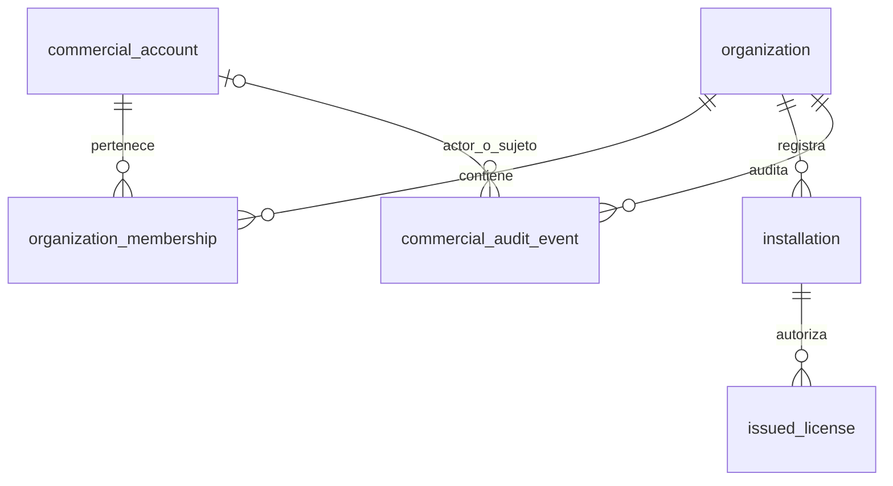

# Identidad comercial P02.1: esquema, aislamiento y retención

La identidad comercial reside en Platform, no en las tablas de usuarios locales del POS. P02.1 **no** incorpora sesiones, credenciales, portal ni rutas comerciales. El token Bearer DEV anterior sigue siendo temporal para el API técnico; no autentica cuentas comerciales. La decisión de diseño está en [ADR-0001](adr-0001-commercial-identity.md).

`issued_license` conserva su PK y sus datos. Una FK compuesta `(installation_id, organization_id)` exige que su organización coincida con la de la instalación. `installation.organization_id` se enlaza por FK a `organization.id`. Ninguna tabla comercial usa borrado en cascada; licencias dejan de borrarse al eliminar una instalación. No se crea tabla `organization_role`: el rol es `owner`, `admin` o `member`, con `role_version = 1` y enum tipado en dominio.

## Diccionario de datos

| Tabla | Columna | Tipo PG | Nulo | Clave / restricción |
| --- | --- | --- | --- | --- |
| `commercial_account` (identidad comercial) | `id` | UUID | No | PK estable |
| | `email` | TEXT | No | UNIQUE; minúsculas y sin bordes de espacio; longitud 3..320, contiene `@` |
| | `display_name` | TEXT | No | nombre no vacío, longitud 1..200 tras recortar |
| | `status` | TEXT | No | `active` / `disabled`; default `active` |
| | `created_at` | TIMESTAMPTZ | No | fecha de alta |
| `organization` (negocio) | `id` | UUID | No | PK estable; FK destino de instalaciones |
| | `display_name` | TEXT | No | nombre no vacío, longitud 1..200 tras recortar |
| | `status` | TEXT | No | `active` / `legacy_unclaimed` / `archived` |
| | `created_at` | TIMESTAMPTZ | No | fecha de alta/importación |
| `organization_membership` (cuenta↔organización) | `organization_id` | UUID | No | PK compuesta, FK `organization(id)` RESTRICT |
| | `account_id` | UUID | No | PK compuesta, FK `commercial_account(id)` RESTRICT |
| | `role` | TEXT | No | CHECK `owner`, `admin`, `member` |
| | `role_version` | SMALLINT | No | CHECK `= 1`, default 1; dominio rechaza otras versiones |
| | `joined_at` | TIMESTAMPTZ | No | inicio de membresía |
| | `revoked_at` | TIMESTAMPTZ | Sí | `>= joined_at` si presente; revocación no elimina historial |
| `installation` (POS técnico existente) | `organization_id` | UUID | No | nueva FK `organization(id)` RESTRICT; `(id, organization_id)` UNIQUE para enlazar licencias |
| `issued_license` (licencia existente) | `installation_id`, `organization_id` | UUID, UUID | No | FK compuesta hacia `installation(id, organization_id)` RESTRICT, no CASCADE |
| `commercial_audit_event` (cambios de identidad) | `id` | UUID | No | PK estable |
| | `organization_id` | UUID | Sí | FK RESTRICT; sólo nulo para `account_created` |
| | `actor_account_id` | UUID | Sí | FK RESTRICT; nulo en `legacy_import` y alta interna `account_created` sin actor autenticado |
| | `subject_account_id` | UUID | Sí | FK RESTRICT; sujeto opcional en importación |
| | `action` | TEXT | No | CHECK: `account_created`, `organization_created`, `membership_added`, `membership_role_changed`, `membership_revoked`, `legacy_import` |
| | `old_role`, `new_role` | TEXT, TEXT | Sí | CHECK roles tipados; alta: nuevo; cambio: ambos; revocación: anterior; resto: nulos |
| | `occurred_at` | TIMESTAMPTZ | No | fecha del hecho, no modificable |

Índices adicionales: `(account_id, organization_id)` parcial de membresías no revocadas; `(organization_id, occurred_at DESC)` y `(subject_account_id, occurred_at DESC)` de auditoría. PK, UNIQUE y FK crean los índices de sus claves. Los índices de instalaciones/licencias de P00 permanecen intactos. No se almacenan contraseñas, hashes de sesión, datos de POS local ni contenidos libres con información personal en auditoría. El disparador `commercial_audit_append_only` impide UPDATE/DELETE de eventos; cuentas, organizaciones y membresías se conservan, con FK `RESTRICT`. La política de retención/anonimización jurídica queda **pendiente**: no implantes borrado físico mientras existan relaciones o auditorías.

## Invariantes y límite de confianza

- La cuenta se normaliza a correo minúsculo; el dominio valida entrada y PostgreSQL refuerza unicidad y restricciones. El correo es identificador comercial provisional, no credencial P02.2.
- Sólo una cuenta activa puede crear organización; alta de organización, membresía `owner` y auditoría ocurren en una transacción.
- Sólo `owner` activo de organización `active` puede añadir, cambiar rol o revocar miembros. Antes del cambio se bloquea la fila de organización para serializar concurrentemente la protección del último `owner`.
- Consultas de miembros e instalaciones requieren membresía no revocada y cuenta activa. El repositorio filtra por el actor y el tenant **en SQL**. Organización inexistente o ajena produce el mismo `NotFound`; conocer UUID no concede acceso.
- El identificador del actor deberá provenir de autenticación verificada en P02.2; **nunca** de `organization_id`/`account_id` del cuerpo, query o URL cliente. Hasta entonces estos casos de uso son exclusivamente internos: no se exponen como rutas ni se interpreta Bearer DEV como identidad de cuenta.
- La auditoría de altas/cambios de membresía se inserta en la misma transacción que la mutación. Intentos no autorizados no alteran datos ni crean eventos. Reincorporación de una membresía revocada queda fuera de P02.1; requiere política de reactivación auditada.

## Migración y compatibilidad

`migrations/0001_init.sql` es inmutable. `0002_commercial_identity.sql` crea tablas y enlaces de forma transaccional. Por cada `organization_id` de instalaciones P00/P01 añade una organización `legacy_unclaimed` (sin cuenta ni membresía) y un evento `legacy_import`; instala FK de instalaciones y licencias. La API DEV ahora requiere un UUID de organización **preexistente** para registrar nuevas instalaciones (404 si falta); instrucciones de prueba sintética en [guía API](../02-development/api.md). No se reclama ni reasigna automáticamente una organización heredada: eso exige comprobación de propiedad en fase posterior.

Si datos heredados contienen licencias con `organization_id` diferente del de su instalación, la FK compuesta hará fallar la migración **sin eliminar ni corregir silenciosamente** datos. Detén despliegue, realiza respaldo y diagnostica inconsistencias con autorización antes de migrar. Sobre bases vacías no hay importación; sobre bases existentes, SQLx verifica checksum de `0001` y aplica sólo la nueva migración. La prueba automatizada valida ambos casos en bases aisladas.
