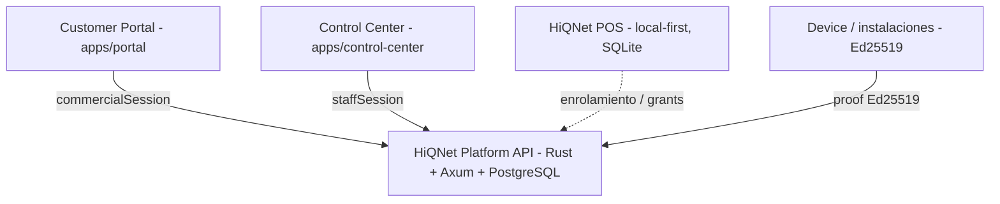

# HiQNet Control Center — Índice rector

Punto de entrada de la arquitectura interna de HiQNet. Define fronteras entre superficies y enlaza las decisiones (ADRs) y documentos de la fase **C0 — Architecture Foundation**.

> **Estado:** C0 ACCEPTED (ratificado 2026-11-09). C1–C5 completados e integrados en `main`: identidad staff, Product/Project, frontend foundation, directorio global Organizations/Accounts y POS Control (último squash `8a78105`, 2026-11-09, PR #20, validado por el CI de `main`). C6 — Audit / Security Center: PENDIENTE / NO INICIADO.

## 1. Superficies

Productos futuros se integran como módulos del Control Center y capacidades de Platform, sin reconstruir la plataforma.

## 2. Identidades (no intercambiables)

| Dominio     | Entidad                     | Superficie      | Autoridad                |
| ----------- | --------------------------- | --------------- | ------------------------ |
| Comercial   | `commercial_account`        | Customer Portal | Organización cliente     |
| Staff       | `staff_account` (propuesta) | Control Center  | Operación interna HiQNet |
| POS local   | identidad local POS         | HiQNet POS      | Venta y operación local  |
| Dispositivo | clave Ed25519               | enrolamiento    | Posesión de clave        |

`devAdminToken` es mecanismo DEV, **no** identidad.

## 3. Fronteras

- Customer Portal sirve `owner/admin/member` de una organización.
- Control Center sirve personal HiQNet con RBAC interno.
- POS sigue siendo local-first; Platform no es dependencia por venta.
- Vistas globales staff no eliminan `organization_id` ni constraints de tenant.
- Toda mutación staff genera auditoría.

## 4. Documentos C0

| Documento                                                      | Contenido                | Estado       |
| -------------------------------------------------------------- | ------------------------ | ------------ |
| [ADR-0004](adr-0004-control-center-boundaries.md)              | Fronteras Control Center | ACCEPTED     |
| [ADR-0005](adr-0005-staff-identity.md)                         | Identidad y auth staff   | ACCEPTED     |
| [ADR-0006](adr-0006-staff-rbac.md)                             | RBAC interno             | ACCEPTED     |
| [ADR-0007](adr-0007-product-project-model.md)                  | Product/Project model    | ACCEPTED     |
| [ADR-0008](adr-0008-control-center-frontend.md)                | Frontend modular         | ACCEPTED     |
| [Threat model](control-center-threat-model.md)                 | Amenazas y mitigaciones  | ACCEPTED     |
| [RBAC matrix](../02-development/control-center-rbac-matrix.md) | Roles y blast radius     | ACCEPTED     |
| [UI direction](control-center-ui-direction.md)                 | 3 conceptos visuales     | ACCEPTED (A) |
| [Roadmap](control-center-roadmap.md)                           | Fases C0–C7              | ACCEPTED     |

## 5. Decisiones ratificadas (2026-11-09)

- Namespace de API: **`control`**.
- Roles y matriz RBAC: los propuestos.
- Modelo Product/Project: el de ADR-0007; DDL en C2.
- Bootstrap de staff: DEV controlado; alta normal auditada.
- Concepto visual: **A — Precision** (con command palette de B).
- Paquetes compartidos: duplicación temporal hasta duplicación real.

## 6. Documentos relacionados existentes

- [ADR-0001 — Identidad comercial](adr-0001-commercial-identity.md)
- [ADR-0002 — Autenticación comercial](adr-0002-authentication-strategy.md)
- [ADR-0003 — Enrolamiento de instalaciones](adr-0003-installation-enrollment.md)
- [Guía de desarrollo local](../02-development/local.md)
- [Portal](../02-development/portal.md)
