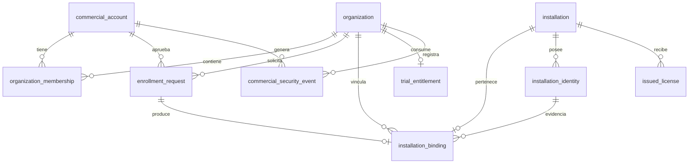

# G4.2 — Modelo de datos propuesto para enrolamiento e identidad de instalaciones

- **Propósito:** definir el esquema objetivo y las invariantes persistidas del enrolamiento.
- **Estado:** PROPOSED — sin DDL, sin migraciones.
- **Fecha:** 2026-11-08.
- **Alcance:** esquema objetivo para G4.2-B/C. Distingue lo existente de lo propuesto.
- **Decisiones:** columnas y tablas dependen de D-A…D-F.
- **Dependencias:** ADR-0003, protocolo y política Trial.
- **Riesgos:** §8.
- **Referencias:** §9.

## 1. Principios

- Migraciones SQLx incrementales y append-only (`0004+`). No se edita lo publicado.
- Claves privadas nunca en PostgreSQL.
- El tenant no se acepta desde el cliente.
- Identidad de instalación = clave pública + historial; el UUID es un handle.
- Elegibilidad Trial es estado persistente, no cálculo en memoria.
- Auditoría y eventos de seguridad append-only.

## 2. Esquema actual (resumen)

| Tabla | Uso actual |
|---|---|
| `commercial_account` | Cuenta comercial (`active`/`disabled`). |
| `organization` | Organización (`active`/`legacy_unclaimed`/`archived`). |
| `organization_membership` | Rol `owner`/`admin`/`member`, `revoked_at`. |
| `commercial_audit_event` | Eventos comerciales append-only con roles. |
| `commercial_credential` | Hash Argon2id. |
| `commercial_session` | Sesiones con hash de token. |
| `commercial_auth_event` | Eventos de autenticación append-only. |
| `installation` | `id`, `organization_id`, `device_label`, estado, timestamps de Trial; sin clave ni actor de enrolamiento. |
| `issued_license` | Grants firmados persistidos. |

Limitaciones relevantes:

- `installation.id` no prueba posesión.
- `(organization_id, device_label)` es único, pero la etiqueta no es identidad.
- No hay historial de vinculación, rehost, rotación ni idempotencia.
- `commercial_audit_event.action` tiene un `CHECK` cerrado sin acciones de instalación.
- El Trial se guarda en `installation` y puede reiniciarse con una fila nueva.

## 3. Esquema objetivo (conceptual)



## 4. Cambios propuestos

### 4.1 `installation` (ALTER, migración nueva)

| Columna | Tipo | Nulo | Restricción / índice | Justificación |
|---|---|---|---|---|
| `identity_status` | `TEXT` | No | `DEFAULT 'legacy'`, `CHECK IN ('legacy','pending','active','revoked')` | Lifecycle de identidad sin reescribir filas históricas. |
| `enrolled_at` | `TIMESTAMPTZ` | Sí | — | Fecha de vinculación efectiva. |
| `enrolled_by_account_id` | `UUID` | Sí | `FK commercial_account(id) ON DELETE RESTRICT` | Actor que aprobó. |
| `revoked_at` | `TIMESTAMPTZ` | Sí | `CHECK (revoked_at IS NULL OR enrolled_at IS NULL OR revoked_at >= enrolled_at)` | Revocación de identidad. |

- Las filas existentes quedan `legacy` y **no** obtienen acceso comercial automático.
- No se añade `public_key` aquí: el historial vive en `installation_identity`.
- `installation.organization_id` es la organización propietaria **permanente**. La unicidad `(id, organization_id)` ya existe desde `0002` y permite la FK compuesta del binding. Un cambio de tenant no se realiza por solicitud del cliente: exige un procedimiento administrativo explícito (PENDIENTE) y probablemente una nueva identidad.

### 4.2 `installation_identity` (nueva)

| Columna | Tipo | Nulo | Restricción / índice | Justificación |
|---|---|---|---|---|
| `id` | `UUID` | No | `PRIMARY KEY` | Identificador de la clave registrada. |
| `installation_id` | `UUID` | No | `FK installation(id) ON DELETE RESTRICT` | Instalación propietaria. |
| `public_key` | `BYTEA` | No | `CHECK (octet_length(public_key) = 32)` | Clave pública Ed25519. |
| `fingerprint` | `BYTEA` | No | `CHECK (octet_length(fingerprint) = 32)` | SHA-256 de la clave pública. |
| `key_version` | `SMALLINT` | No | `CHECK (key_version >= 1)` | Versionado del formato. |
| `created_at` | `TIMESTAMPTZ` | No | — | Alta. |
| `retired_at` | `TIMESTAMPTZ` | Sí | `CHECK (retired_at IS NULL OR retired_at >= created_at)` | Rotación/revocación. |
| `generation` | `SMALLINT` | No | `DEFAULT 1`, `CHECK (generation >= 1)` | Secuencia de rotación para detectar anomalías; no es prueba física. |

Índices:

- `UNIQUE (fingerprint) WHERE retired_at IS NULL` — una clave activa no puede pertenecer a dos instalaciones.
- `UNIQUE (installation_id) WHERE retired_at IS NULL` — una clave activa por instalación.
- `UNIQUE (installation_id, generation)` — secuencia de rotación sin repetir generación.
- `INDEX (installation_id, created_at DESC)` — historial de rotación.

Ciclo de vida: `active` (`retired_at IS NULL`) → `retired` (`retired_at` no nulo). Nunca se borra.

Retención: permanente mientras exista la instalación; conserva evidencia de rotación.

### 4.3 `enrollment_request` (nueva)

| Columna | Tipo | Nulo | Restricción / índice | Justificación |
|---|---|---|---|---|
| `id` | `UUID` | No | `PRIMARY KEY` | Identificador interno. |
| `installation_id` | `UUID` | No | — | Handle propuesto por el POS; no autoriza. |
| `public_key` | `BYTEA` | No | `CHECK (octet_length(public_key) = 32)` | Clave a vincular. |
| `fingerprint` | `BYTEA` | No | `CHECK (octet_length(fingerprint) = 32)` | Búsqueda de duplicados. |
| `device_label` | `TEXT` | No | `CHECK (length(btrim(device_label)) BETWEEN 1 AND 120)` | Metadato UX. |
| `app_version` | `TEXT` | No | `CHECK (length(app_version) <= 40)` | Compatibilidad. |
| `platform` | `TEXT` | No | `CHECK IN ('windows','linux','android','unknown')` | Diagnóstico. |
| `device_code_hash` | `BYTEA` | No | `UNIQUE` | Nunca se guarda el código crudo. |
| `user_code_hash` | `BYTEA` | No | `UNIQUE` | Código legible de un solo uso. |
| `nonce_hash` | `BYTEA` | No | — | Prueba de posesión; el nonce crudo se devuelve una vez. |
| `status` | `TEXT` | No | `CHECK IN ('pending','approved','completed','expired','cancelled')` | Máquina de estados. |
| `organization_id` | `UUID` | Sí | `FK organization(id) ON DELETE RESTRICT` | Fijada en la aprobación. |
| `approved_by_account_id` | `UUID` | Sí | `FK commercial_account(id) ON DELETE RESTRICT` | Actor que aprobó. |
| `created_at` | `TIMESTAMPTZ` | No | — | Emisión. |
| `expires_at` | `TIMESTAMPTZ` | No | `CHECK (expires_at > created_at)` | TTL. |
| `approved_at` | `TIMESTAMPTZ` | Sí | — | Transición. |
| `consumed_at` | `TIMESTAMPTZ` | Sí | `CHECK (consumed_at IS NULL OR status = 'completed')` | Consumo único. |
| `cancelled_at` | `TIMESTAMPTZ` | Sí | — | Cancelación. |
| `idempotency_scope` | `TEXT` | Sí | — | Alcance de idempotencia. |
| `idempotency_key` | `TEXT` | Sí | — | Clave del cliente. |
| `request_hash` | `BYTEA` | Sí | — | Detección de payload distinto. |

Índices:

- `INDEX (status, expires_at)` — limpieza y expiración.
- `INDEX (organization_id, created_at DESC)` — auditoría operativa.
- `UNIQUE (idempotency_scope, idempotency_key) WHERE idempotency_key IS NOT NULL`.

Reglas de transición (aplicadas por SQL, no solo en Rust):

- `pending → approved` solo con `approved_by_account_id` y `organization_id` no nulos, y con `owner` activo verificado en la misma transacción.
- `approved → completed` solo con `consumed_at` fijado, firma válida y **revalidación vigente** de organización activa, cuenta activa, membresía activa y rol `owner`; todo en la misma transacción que el binding.
- `pending|approved → expired|cancelled` sin consumo.
- `completed`, `expired`, `cancelled` son terminales.
- Si la revalidación falla, no hay transición: la solicitud permanece `approved` hasta expirar y se registra un evento de seguridad en una transacción independiente (`authorization_revoked_during_proof` u otro evento equivalente). Ese registro es best-effort: si falla, el enrolamiento sigue denegado y el fallo se registra con tracing sanitizado, pero no puede convertir la ausencia de telemetría en autorización ni dejar una vinculación parcial.

Retención propuesta: 90 días tras el estado terminal, salvo obligación de auditoría; los eventos de auditoría asociados se conservan.

### 4.4 `installation_binding` (nueva)

| Columna | Tipo | Nulo | Restricción / índice | Justificación |
|---|---|---|---|---|
| `id` | `UUID` | No | `PRIMARY KEY` | Identificador del vínculo. |
| `organization_id` | `UUID` | No | `FK organization(id) ON DELETE RESTRICT` | Tenant. |
| `installation_id` | `UUID` | No | FK compuesta `(installation_id, organization_id)` → `installation(id, organization_id)` | Instalación y tenant coherentes. |
| `enrollment_request_id` | `UUID` | No | `FK enrollment_request(id) ON DELETE RESTRICT`, `UNIQUE` | Origen del vínculo. |
| `installation_identity_id` | `UUID` | No | `FK installation_identity(id) ON DELETE RESTRICT` | Clave vigente al vincular; el historial de rotación queda en `installation_identity`. |
| `approved_by_account_id` | `UUID` | No | `FK commercial_account(id) ON DELETE RESTRICT` | Actor. |
| `bound_at` | `TIMESTAMPTZ` | No | — | Alta. |
| `revoked_at` | `TIMESTAMPTZ` | Sí | `CHECK (revoked_at IS NULL OR revoked_at >= bound_at)` | Rehost/revocación. |
| `revoke_reason` | `TEXT` | Sí | — | Trazabilidad. |

Índices y reglas:

- `UNIQUE (installation_id) WHERE revoked_at IS NULL` — **un único binding activo por instalación**.
- `INDEX (organization_id, bound_at DESC)` — listado.
- No existe un `UNIQUE(organization_id, installation_id)` permanente: impediría revincular la misma pareja tras un rehost o una rotación dentro de la misma organización. Las filas históricas pueden repetir la pareja y se distinguen por `bound_at`/`revoked_at`.
- `installation.organization_id` es la organización propietaria permanente y debe coincidir con la del binding; la FK compuesta lo garantiza. No se actualiza por solicitud del cliente.
- Los bindings no se borran ni se reescriben: se cierran con `revoked_at` y `revoke_reason` (historial append-only por cierre de vigencia).
- Un cambio de tenant exige un procedimiento administrativo explícito, fuera del enrolamiento; probablemente con nueva identidad de instalación (PENDIENTE).

### 4.5 `trial_entitlement` (nueva)

| Columna | Tipo | Nulo | Restricción / índice | Justificación |
|---|---|---|---|---|
| `organization_id` | `UUID` | No | `PRIMARY KEY`, `FK organization(id) ON DELETE RESTRICT` | Autoridad por organización (recomendada). |
| `status` | `TEXT` | No | `CHECK IN ('available','consumed','revoked')` | Elegibilidad persistente. |
| `started_at` | `TIMESTAMPTZ` | Sí | — | Inicio efectivo. |
| `ends_at` | `TIMESTAMPTZ` | Sí | `CHECK (ends_at IS NULL OR started_at IS NULL OR ends_at > started_at)` | Fin del Trial. |
| `source` | `TEXT` | No | `CHECK IN ('platform','legacy_local')` | Origen de la decisión. |
| `consumed_by_installation_id` | `UUID` | Sí | `FK installation(id) ON DELETE RESTRICT` | Evidencia. |
| `first_seen_account_id` | `UUID` | Sí | `FK commercial_account(id) ON DELETE RESTRICT` | Señal secundaria de abuso. |
| `created_at` | `TIMESTAMPTZ` | No | — | Alta. |
| `updated_at` | `TIMESTAMPTZ` | No | — | Última transición. |

Regla: una fila por organización; `consumed` es terminal. La política exacta de cuenta vs organización está PENDIENTE.

### 4.6 `idempotency_record` (nueva)

| Columna | Tipo | Nulo | Restricción / índice | Justificación |
|---|---|---|---|---|
| `scope` | `TEXT` | No | `PRIMARY KEY` parte | `account:<uuid>`, `installation:<uuid>` o `ip:<hash>`. |
| `endpoint` | `TEXT` | No | `PRIMARY KEY` parte | Ruta lógica. |
| `key` | `TEXT` | No | `PRIMARY KEY` parte | `Idempotency-Key`. |
| `request_hash` | `BYTEA` | No | — | Detección de payload distinto. |
| `response_status` | `SMALLINT` | No | — | Respuesta previa. |
| `response_body` | `JSONB` | Sí | `CHECK (NOT (secrets_delivered AND response_body IS NOT NULL))` | Solo respuestas **sin** material bearer. |
| `secrets_delivered` | `BOOLEAN` | No | `DEFAULT false` | Marca respuestas cuyo cuerpo contenía códigos bearer y no se almacena. |
| `created_at` | `TIMESTAMPTZ` | No | — | Alta. |
| `expires_at` | `TIMESTAMPTZ` | No | `CHECK (expires_at > created_at)` | Limpieza. |

Reglas:

- Para `/enrollment-requests` (inicio), `response_body` es `NULL` y `secrets_delivered = true`; el `CHECK` impide guardar la respuesta con secretos.
- `response_body` solo se usa en respuestas no secretas (aprobación, consulta, error normalizado).
- La semántica de reintento está en [protocolo §7](g42-enrollment-protocol.md#7-idempotencia-secretos-y-reintentos).
- Nunca se almacena `device_code`, `user_code` ni `nonce` en claro.

Retención propuesta: 7 días.

### 4.7 `commercial_security_event` (nueva)

| Columna | Tipo | Nulo | Restricción / índice | Justificación |
|---|---|---|---|---|
| `id` | `UUID` | No | `PRIMARY KEY` | Evento. |
| `kind` | `TEXT` | No | `CHECK IN ('enrollment_conflict','duplicate_key','tenant_change_attempt','replay_rejected','rehost_performed','identity_revoked','authorization_revoked_during_proof','idempotency_conflict','clone_suspected')` | Taxonomía inicial. |
| `account_id` | `UUID` | Sí | `FK commercial_account(id) ON DELETE RESTRICT` | Actor si existe. |
| `organization_id` | `UUID` | Sí | `FK organization(id) ON DELETE RESTRICT` | Tenant si existe. |
| `installation_id` | `UUID` | Sí | — | Referencia no FK para conservar evidencia si se revoca. |
| `occurred_at` | `TIMESTAMPTZ` | No | — | Fecha. |
| `ip_hash` | `BYTEA` | Sí | — | Correlación sin PII. |
| `metadata` | `JSONB` | No | `DEFAULT '{}'` | Contexto acotado. |

Índices: `(kind, occurred_at DESC)`, `(organization_id, occurred_at DESC)`. Trigger append-only.

Retención propuesta: 1 año; PENDIENTE.

### 4.8 `commercial_audit_event` (ALTER del CHECK)

Acciones nuevas propuestas:

- `installation_enrolled`
- `installation_rehosted`
- `installation_revoked`
- `installation_key_rotated`
- `trial_activated`
- `trial_denied`

La migración debe recrear el `CHECK` conservando las acciones actuales. La tabla sigue append-only.

### 4.9 `issued_license` (sin cambios en G4.2-A)

El contrato v1 se mantiene. No se añade clave pública del dispositivo al grant; hacerlo exigiría v2 y compatibilidad. La emisión futura deberá validar identidad y elegibilidad antes de firmar.

## 5. Esquema físico resumido

```text
installation(id PK, organization_id FK, device_label, status,
             trial_started_at, trial_ends_at,
             identity_status, enrolled_at, enrolled_by_account_id, revoked_at)

installation_identity(id PK, installation_id FK, public_key BYTEA,
                      fingerprint BYTEA, key_version, created_at, retired_at)
  UNIQUE(fingerprint) WHERE retired_at IS NULL
  UNIQUE(installation_id) WHERE retired_at IS NULL

enrollment_request(id PK, installation_id, public_key, fingerprint,
                   device_label, app_version, platform,
                   device_code_hash UNIQUE, user_code_hash UNIQUE, nonce_hash,
                   status, organization_id FK, approved_by_account_id FK,
                   created_at, expires_at, approved_at, consumed_at,
                   cancelled_at, idempotency_scope, idempotency_key, request_hash)

installation_binding(id PK, organization_id FK, installation_id,
                     enrollment_request_id FK UNIQUE, installation_identity_id FK,
                     approved_by_account_id FK, bound_at, revoked_at, revoke_reason)
  FK (installation_id, organization_id) -> installation(id, organization_id)
  UNIQUE(installation_id) WHERE revoked_at IS NULL

trial_entitlement(organization_id PK, status, started_at, ends_at, source,
                  consumed_by_installation_id FK, first_seen_account_id FK,
                  created_at, updated_at)

idempotency_record(scope, endpoint, key, request_hash, response_status,
                   response_body, secrets_delivered, created_at, expires_at)
  PK(scope, endpoint, key)
  CHECK (NOT (secrets_delivered AND response_body IS NOT NULL))

commercial_security_event(id PK, kind, account_id FK, organization_id FK,
                          installation_id, occurred_at, ip_hash, metadata)
```

## 6. Reglas de integridad clave

| Regla | Mecanismo |
|---|---|
| Una clave activa por instalación | Índice único parcial. |
| Una clave activa en una sola instalación | Índice único parcial por fingerprint. |
| Un binding activo por instalación | Índice único parcial en binding. |
| Binding coherente con la organización propietaria | FK compuesta a `installation(id, organization_id)`. |
| Revinculación tras rehost sin perder historia | Cierre con `revoked_at`; el `UNIQUE` permanente no existe. |
| Sin cambio silencioso de tenant | `installation.organization_id` inmutable; migración administrativa explícita. |
| Consumo único de challenge | `consumed_at` + transición condicional. |
| Trial único por organización | PK en `trial_entitlement`. |
| Idempotencia persistente | PK compuesta y hash de payload. |
| Sin secretos bearer en idempotencia | `response_body NULL` cuando `secrets_delivered = true`. |
| Auditoría inmutable | Trigger existente y nuevo. |

## 7. Compatibilidad y migración

- Las instalaciones existentes quedan `identity_status='legacy'`; no se borran ni se reasignan.
- Las organizaciones antiguas sin Trial registrado quedan `available` o `legacy_local` según decisión pendiente.
- Las migraciones serán `0004_installation_identity.sql`, `0005_enrollment.sql`, etc.
- Toda migración debe probar upgrade desde `0003` y desde base vacía, con checksums intactos.

## 8. Dependencias y riesgos

- **Depende de:** ADR-0003 aprobado, decisiones D-A…D-F y del plan de migraciones.
- **Riesgo principal:** implementar las tablas antes de confirmar la autoridad del Trial y el tratamiento de instalaciones heredadas.
- **Riesgo de datos:** migrar instalaciones existentes como `legacy` sin conceder acceso; requires prueba de upgrade desde `0003`.
- **Compatibilidad:** el esquema nuevo no altera `issued_license` ni el grant v1.

## 9. Referencias

- [ADR-0003](adr-0003-installation-enrollment.md)
- [Protocolo](g42-enrollment-protocol.md)
- [Política de Trial y rehost](g42-trial-eligibility-rehost-policy.md)
- [Plan de implementación](g42-implementation-plan.md)
