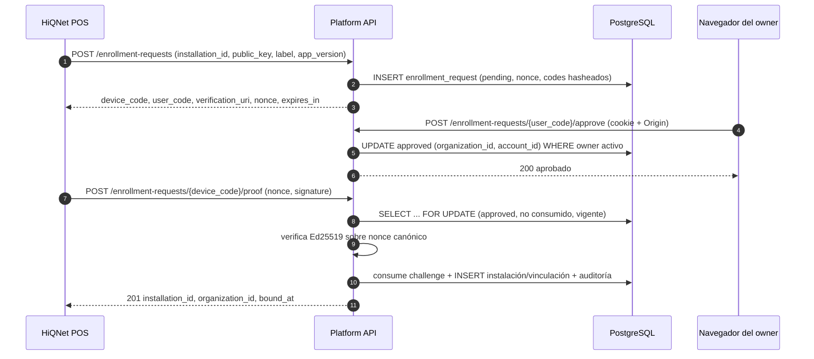
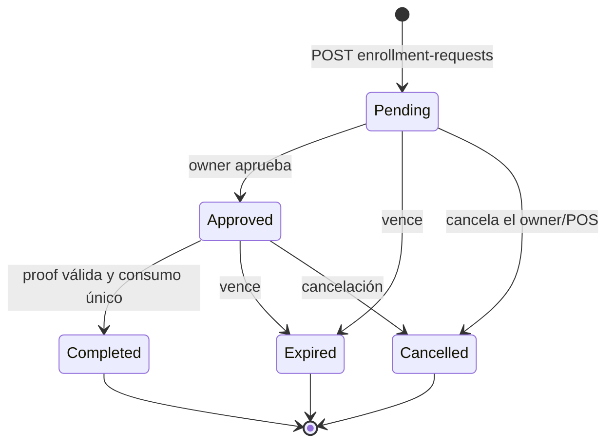
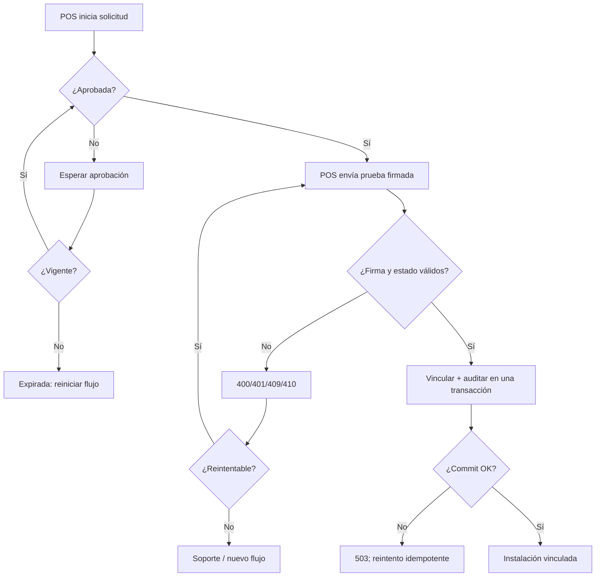

# G4.2 — Protocolo propuesto de enrolamiento seguro POS ↔ Platform

- **Propósito:** especificar el intercambio, los estados y las validaciones del enrolamiento propuesto.
- **Estado:** PROPOSED — no aprobado, no implementado.
- **Fecha:** 2026-11-08.
- **Alcance:** intercambio entre HiQNet POS, navegador del propietario y Platform para vincular una instalación a una organización.
- **Decisiones:** ver §15 y la matriz de decisiones.
- **Dependencias:** ADR-0003, modelo de amenazas y modelo de datos.
- **Riesgos:** §16.
- **Referencias:** §17.

## 1. Principios

1. El navegador autentica a la persona y la organización.
2. El POS demuestra posesión de una clave privada Ed25519.
3. Platform decide autorización, elegibilidad y persistencia.
4. Ningún UUID ni etiqueta concede autoridad.
5. El enrolamiento no activa Trial ni emite licencias.

## 2. Participantes y canales

| Participante | Canal | Autoridad |
|---|---|---|
| POS | HTTPS público, rate-limited | Posee clave privada del dispositivo |
| Navegador | HTTPS con cookie `hiqnet_session` | Actor comercial autenticado |
| Platform | Axum + PostgreSQL | Autoridad de decisión y persistencia |

## 3. Secuencia propuesta



## 4. Mensajes

### 4.1 Inicio — `POST /api/v1/enrollment-requests`

Público, sin sesión, rate-limited, `Content-Type: application/json`.

```json
{
  "installation_id": "6f1c0f0e-6a55-4d1e-9a2b-7a3f9f2a1c10",
  "public_key": "ed25519:v1:AbCd...",
  "device_label": "Caja mostrador",
  "app_version": "0.1.0",
  "platform": "windows"
}
```

| Campo | Tipo | Requerido | Notas |
|---|---|---|---|
| `installation_id` | UUID | Sí | Handle local; **no** autoriza. |
| `public_key` | string | Sí | `ed25519:v1:<base64url>`; 32 bytes. |
| `device_label` | string | Sí | 1–120 caracteres; no es identidad. |
| `app_version` | string | Sí | Para compatibilidad y diagnóstico. |
| `platform` | enum | Sí | `windows`/`linux`/`android`/`unknown`. |

Respuesta `201`:

```json
{
  "device_code": "b64url:...",
  "user_code": "ABCD-EFGH",
  "verification_uri": "https://platform.example.test/enroll",
  "nonce": "b64url:...",
  "expires_in": 600
}
```

- `device_code` y `nonce` se devuelven **una vez**; el servidor guarda sus hashes y el nonce asociado a la solicitud.
- `user_code` es legible y de un solo uso.
- Expiración propuesta: 10 minutos (PENDIENTE de aprobación).
- `Idempotency-Key` opcional. La respuesta contiene material bearer y **no** se almacena en claro: un reintento con la misma clave y payload devuelve `409 enrollment_restart_required` sin secretos. El POS debe iniciar una solicitud nueva con otra clave (ver §7).

### 4.2 Aprobación — `POST /api/v1/enrollment-requests/{user_code}/approve`

Requiere cookie comercial y `Origin` exacto (CSRF).

```json
{ "organization_id": "2f6a7c1e-..." }
```

- El actor debe ser `owner` activo de la organización (decisión A recomendada).
- La organización se fija en la solicitud; el POS no puede cambiarla.
- Respuesta `204` o `200` con `{ "approved": true }`.
- Errores: `400` código inválido; `401` sesión; `403` origen o rol; `404` organización ajena/inexistente o código desconocido (neutral); `409` ya aprobada/cancelada/expirada; `429`.

### 4.3 Prueba — `POST /api/v1/enrollment-requests/{device_code}/proof`

Público, rate-limited.

```json
{
  "installation_id": "6f1c0f0e-...",
  "public_key": "ed25519:v1:AbCd...",
  "nonce": "b64url:...",
  "signature": "b64url:..."
}
```

- El POS reenvía el `nonce` recibido en el inicio; el servidor comprueba `sha256(nonce)` contra `nonce_hash` antes de verificar la firma. El nonce no concede autoridad por sí mismo, pero no se recupera en reintentos.

Firma canónica sobre bytes UTF-8 de:

```text
hiqnet-enrollment-proof:v1
request=<device_code>
installation=<installation_id>
key=<public_key>
nonce=<nonce>
```

- Se usa el `device_code` recibido, no su hash.
- La firma cubre la clave y la instalación para impedir sustitución.
- La verificación inicial comprueba: solicitud existente, `approved`, no expirada, no consumida, `installation_id` y `public_key` idénticos a los del inicio, `sha256(nonce)` coincide con el hash persistido y firma válida.
- Antes de confirmar el binding, la transacción **revalida la autoridad vigente** (no confía en la aprobación previa):
  1. Solicitud `approved`, vigente y no consumida.
  2. Organización `active`.
  3. Cuenta aprobadora `active`.
  4. Membresía activa del aprobador (`revoked_at IS NULL`).
  5. Rol `owner` vigente (`role_version = 1`).
  6. Instalación sin binding activo en otro tenant.
  7. Clave pública sin conflicto con otra identidad activa.
  8. Consumo, vinculación y auditoría en la misma transacción.
- Si la autoridad cambió entre `/approve` y `/proof`, el binding se rechaza con `409 enrollment_invalid` y se registra un evento de seguridad; no se revela si fue revocación, archivado o conflicto.
- Respuesta `201`:

```json
{
  "installation_id": "6f1c0f0e-...",
  "organization_id": "2f6a7c1e-...",
  "role": "owner",
  "bound_at": "2026-11-08T12:00:00Z"
}
```

- Errores: `400` payload/canonicalización/firma inválida; `404` solicitud desconocida (neutral); `409` estado/autorización/conflicto (`enrollment_invalid`); `410` expirada/cancelada; `429`; `503`.

### 4.4 Consulta de instalaciones (fase posterior)

- `GET /api/v1/organizations/{id}/installations` — cualquier miembro activo; paginación por cursor; datos mínimos.
- `GET /api/v1/organizations/{id}/installations/{installation_id}` — cualquier miembro activo; 404 neutral cross-tenant.

Estas rutas no forman parte del enrolamiento mínimo y pueden posponerse si G4.2-B ya cubre la vinculación.

## 5. Estados



Estados persistidos: `pending`, `approved`, `completed`, `expired`, `cancelled`. Solo `approved` puede pasar a `completed`.

## 6. Validaciones y errores

| Validación | Resultado |
|---|---|
| Cuerpo malformado o campo desconocido | 400 |
| UUID inválido | 400 |
| Clave pública no Ed25519 o longitud incorrecta | 400 |
| `device_label` vacío o > 120 | 400 |
| Código desconocido | 404 neutral |
| Organización ajena o inexistente en approve | 404 neutral |
| Actor sin `owner` en approve | 403 si pertenece a la org |
| Revocación/archivado/deshabilitación durante proof | 409 `enrollment_invalid` neutral |
| Solicitud expirada o cancelada | 410 |
| Solicitud ya consumida | 409 |
| Firma inválida | 400 (sin revelar detalle) |
| Reintento de inicio sin secretos recuperables | 409 `enrollment_restart_required` |
| Misma clave con distinto `installation_id` activo | 409 + evento de seguridad |
| Instalación ya vinculada a otra organización | 409 + evento de seguridad |
| Misma clave y mismo `installation_id` | No detectable; sin 409 garantizado |
| Etiqueta duplicada en la organización | 409 |
| PostgreSQL no disponible | 503 |
| Rate limit | 429 |

Mensajes de error normalizados, sin SQL, claves ni trazas.

## 7. Idempotencia, secretos y reintentos

### 7.1 Decisión propuesta: entrega única (A)

El inicio devuelve `device_code`, `user_code` y `nonce`, que son material de enrolamiento sensible. Se recomienda **no recuperarlos** en reintentos:

- PostgreSQL guarda hashes y estado, nunca los códigos crudos.
- `idempotency_record` puede almacenar respuestas **sin secretos**; para el inicio, `response_body` queda `NULL` y `secrets_delivered = true`.
- Si el POS pierde la respuesta, reinicia el flujo con una `Idempotency-Key` nueva y una solicitud nueva.

Alternativa B (respuesta recuperable cifrada) se difiere: exige una clave de servicio, rotación, control de acceso y una ventana de exposición; añade infraestructura y superficie para un POS sencillo. Podrá reevaluarse si la operación demuestra que el reinicio es costoso.

### 7.2 Semántica por escenario

| # | Escenario | Comportamiento | HTTP |
|---|---|---|---|
| 1 | Primer inicio | Crea solicitud, persiste hashes, devuelve secretos una vez | `201` |
| 2 | Reintento antes de recibir respuesta | No recupera secretos; indica reiniciar | `409 enrollment_restart_required` |
| 3 | Timeout después de persistir | Igual que 2; la solicitud queda `pending` hasta expirar | `409` |
| 4 | Misma `Idempotency-Key` y mismo payload | Devuelve el resultado **no secreto** previo (estado/`restart_required`), sin secretos | `409`/`200` según endpoint |
| 5 | Misma clave y payload distinto | Conflicto estable, evento de seguridad | `409 idempotency_conflict` |
| 6 | Código expirado | No se acepta; se requiere flujo nuevo | `410` |
| 7 | Código consumido | No se repite el efecto; replay idempotente solo devuelve datos no secretos del binding si coinciden clave y payload | `409` o `201` idempotente |
| 8 | Solicitud cancelada | Terminal | `410` |
| 9 | Reinicio del POS antes de completar | Secretos perdidos; nueva solicitud; la anterior se cancela o expira | `409` + flujo nuevo |

### 7.3 Reglas adicionales

- Aprobación: respuesta sin secretos; repetir sobre `approved` devuelve el estado actual sin duplicar.
- Prueba: el consumo es único; el resultado (IDs y fecha) no es secreto y puede devolverse de forma idempotente si coinciden clave y payload.
- Una solicitud nueva para el mismo `installation_id` cancela las solicitudes `pending`/`approved` anteriores de ese dispositivo (o las deja expirar), para evitar acumulación.
- No se depende de memoria para idempotencia.
- Ningún código bearer recuperable se guarda como JSON en claro. Si en el futuro se adopta la alternativa B, se hará con cifrado de servicio, expiración y borrado controlado, y seguirá prohibido el texto claro.

## 8. Concurrencia, bloqueos y atomicidad

Orden de bloqueos (compatible con P02.3):

1. `enrollment_request` de la solicitud, `FOR UPDATE`.
2. `organization` de la organización aprobada, `FOR UPDATE` (mismo recurso que bloquea P02.3 al administrar membresías).
3. Relectura de `commercial_account` y `organization_membership` del aprobador.
4. Verificación de índices únicos de `installation_identity` y `installation_binding`.

Ninguna ruta bloquea la organización y después la solicitud, por lo que no se crea un ciclo con la administración de membresías.

Bloqueo explícito de la cuenta aprobadora y decisión transaccional:

- La comprobación `commercial_account.status = 'active'` no puede leerse una sola vez fuera de la transacción ni servir como autoridad final. La `/proof` debe revalidarla después de bloquear la solicitud y la organización.
- Para sincronizar una deshabilitación concurrente basta `SELECT ... FROM commercial_account WHERE id = $approved_by_account_id AND status = 'active' FOR SHARE`; `FOR KEY SHARE` no es suficiente, porque el UPDATE de `status` adquiere `FOR NO KEY UPDATE` y sólo `FOR SHARE` (o un modo superior) bloquea ese tipo de escritura. Se elige `FOR SHARE` por ser el mínimo compatible con los bloqueos ya usados por membresías, sin introducir un lock más fuerte del necesario.
- El orden de locks en `/proof` es, además de los índices de identidad/binding, `enrollment_request` → `organization` → `commercial_account` → `organization_membership` → identidad/binding. No se bloquea `organization` después de la cuenta ni se bloquea la cuenta antes que la solicitud; así no se invierte el orden de P02.3 (cuenta → organización en creación de organización, organización → membresía en administración de membresías).
- `FOR SHARE` sobre la cuenta permite leer otros bloqueos concurrentes pero impide el `UPDATE` de deshabilitación hasta que la transacción concluya; si la deshabilitación ya confirmó antes de la relectura, el predicado falla y la prueba se rechaza.

Predicados mínimos de la transacción de `/proof`:

```sql
-- 1) solicitud
SELECT id, organization_id, approved_by_account_id
FROM enrollment_request
WHERE id = $1
  AND status = 'approved'
  AND consumed_at IS NULL
  AND expires_at > clock_timestamp()
FOR UPDATE;

-- 2) organización + autoridad vigente del aprobador
SELECT o.id
FROM organization o
JOIN organization_membership m
  ON m.organization_id = o.id
 AND m.account_id = $2
 AND m.revoked_at IS NULL
 AND m.role = 'owner'
 AND m.role_version = 1
JOIN commercial_account a
  ON a.id = m.account_id
 AND a.status = 'active'
WHERE o.id = $3
  AND o.status = 'active'
FOR UPDATE OF o;
```

Si la relectura no devuelve fila, se revierte todo y se responde `409 enrollment_invalid`.

Semántica de carreras:

- Dos pruebas concurrentes: la primera adquiere el bloqueo de solicitud y consume; la segunda, al esperar y releer, ve `consumed_at` no nulo y recibe `409`.
- Auditoría y evento de seguridad son cosas distintas: la auditoría `installation_enrolled` forma parte de la transacción exitosa y se revierte si falla el commit. El evento `authorization_revoked_during_proof` corresponde a un intento rechazado y se intenta escribir en una transacción separada después del rollback de la prueba; si no se persiste, el enrolamiento permanece denegado y el fallo sólo se registra con tracing sanitizado. Un fallo de telemetría nunca se interpreta como autorización para completar el binding.
- Si el registro best-effort del evento de seguridad falla, la respuesta sigue siendo `409`; la operación no se repite a posteriori para completarla.
- Revocación mientras `/proof` espera el bloqueo de organización: al obtenerlo, la siguiente sentencia usa una instantánea nueva (READ COMMITTED) y la relectura de membresía falla; se revierte y se registra `authorization_revoked_during_proof`.
- Si `/proof` confirma antes del commit de la revocación, el binding queda; la revocación posterior no reescribe el historial y las consultas/licencias futuras vuelven a comprobar la autoridad.
- Cancelación concurrente con prueba: gana quien confirme primero; el otro recibe `409`/`410`.
- Aprobación concurrente: exactamente una transición a `approved`.

Atomicidad: consumo del challenge, validación de identidad, creación/actualización de binding y auditoría se confirman o revierten juntos.

## 9. Cancelación e interrupciones

- `POST /enrollment-requests/{device_code}/cancel` (opcional) o expiración por tiempo.
- Si el POS se cierra tras el inicio: los secretos se pierden y la solicitud expira; para continuar se inicia un flujo nuevo.
- Si se cierra tras la aprobación y antes de la prueba: el owner puede reintentar dentro de la vigencia; pasado el plazo, se repite el flujo.
- Si se interrumpe la respuesta de proof después del commit: el reintento idempotente devuelve la vinculación existente (datos no secretos).

## 10. Flujo de error y recuperación



## 11. Límites de confianza

- El POS no puede fijar la organización ni el rol.
- El navegador no recibe la clave privada.
- Platform no recibe la clave privada.
- La aprobación no emite licencia.
- El `installation_id` es un handle idempotente, no una credencial.
- El `device_label` es metadato de UX, no identidad.

## 12. Rate limiting propuesto

| Endpoint | Límite implementado | Estado |
|---|---|---|
| Inicio | configurable por peer TCP (`ConnectInfo`) | IMPLEMENTADO |
| Aprobación | configurable por `account_id` | IMPLEMENTADO |
| Prueba | configurable por peer TCP (`ConnectInfo`) | IMPLEMENTADO |

Los valores son técnicos y no representan cuotas comerciales. No se confían `X-Forwarded-For` ni `Forwarded` sin lista explícita de proxies. El limitador es por instancia; G4.2-E evaluará uno distribuido.

Riesgo registrado: el `user_code` humano tiene del orden de 40 bits de entropía y se indexa mediante SHA-256. No se cambia silenciosamente a HMAC/pepper en G4.2-B; queda pendiente evaluar un blind index con secreto de servidor. `device_code` y `nonce` tienen alta entropía y no comparten esa limitación.

## 13. Relación con Trial y licencias

- Enrolamiento: vincula organización e instalación. No activa Trial.
- Elegibilidad/Trial: operación separada, con política persistente (ver [política](g42-trial-eligibility-rehost-policy.md)).
- Licenciamiento: emite grants firmados; depende de identidad y elegibilidad, pero no las modifica.
- No hay dependencia circular: enrolamiento no necesita un grant; el grant no crea identidad.

## 14. Compatibilidad y migración

- El POS actual genera UUID local y Trial local al hacer bootstrap. G4.2-D deberá definir cómo convive con el enrolamiento sin duplicar Trials.
- El `LicenseGrant` v1 no cambia en G4.2-A.
- Las instalaciones DEV existentes pueden migrarse como `legacy` sin clave, con estado explícito y sin acceso comercial automático.
- No se modifica ninguna migración publicada.

## 15. Preguntas abiertas

1. ¿Se exige `owner` o también `admin`?
2. ¿Expiración de 10 minutos es suficiente?
3. ¿Se requiere `verification_uri` con deep link o basta código manual?
4. ¿Se admite cancelación explícita?
5. ¿Se persiste `platform` y `app_version` con fines de compatibilidad?
6. ¿La prueba debe firmar también el `user_code`?
7. ¿Se requiere un segundo factor para rehost?

## 16. Dependencias y riesgos

- **Depende de:** aprobación del ADR, decisiones de rol, expiración y custodia de claves.
- **Riesgo principal:** que el flujo se implemente antes de aprobar la política de Trial y termine acoplado a decisiones no ratificadas.
- **Dependencia técnica:** el POS necesita custodia de clave y una UI de vinculación (G4.2-D).
- **Compatibilidad:** cualquier cambio del formato de prueba exige versión explícita y rechazo de versiones desconocidas.

## 17. Referencias

- [ADR-0003](adr-0003-installation-enrollment.md)
- [Modelo de amenazas](g42-enrollment-threat-model.md)
- [Modelo de datos](g42-data-model.md)
- [Política de Trial y rehost](g42-trial-eligibility-rehost-policy.md)
