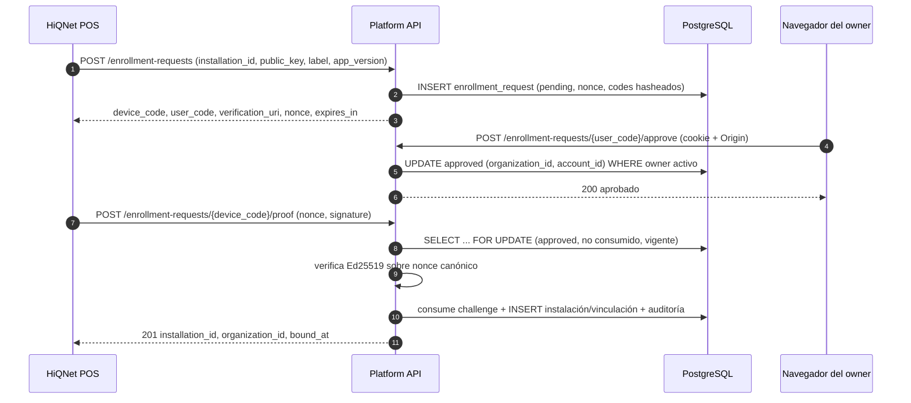
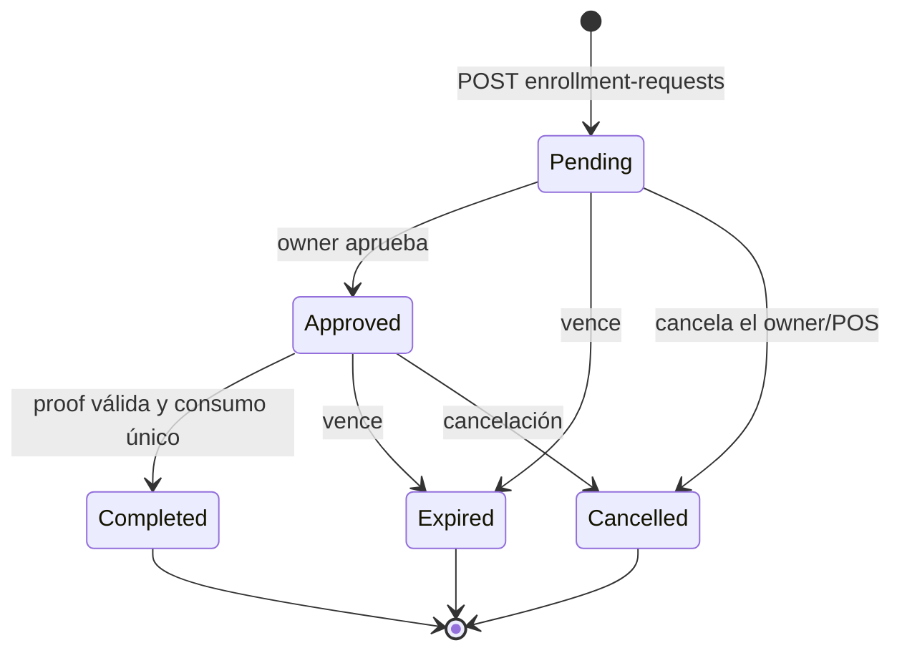
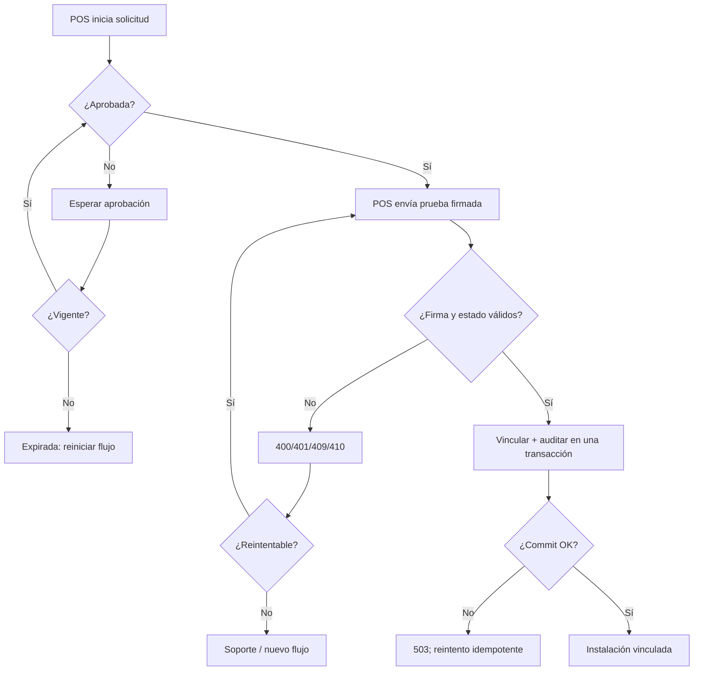

# G4.2 — Protocolo propuesto de enrolamiento seguro POS ↔ Platform

- **Propósito:** especificar el intercambio, los estados y las validaciones del enrolamiento propuesto.
- **Estado:** PROPOSED — no aprobado, no implementado.
- **Fecha:** 2026-11-08.
- **Alcance:** intercambio entre HiQNet POS, navegador del propietario y Platform para vincular una instalación a una organización.
- **Decisiones:** ver §15 y la matriz de decisiones.
- **Dependencias:** ADR-0003, modelo de amenazas y modelo de datos.
- **Riesgos:** §16.
- **Referencias:** §17.

## 1. Principios

1. El navegador autentica a la persona y la organización.
2. El POS demuestra posesión de una clave privada Ed25519.
3. Platform decide autorización, elegibilidad y persistencia.
4. Ningún UUID ni etiqueta concede autoridad.
5. El enrolamiento no activa Trial ni emite licencias.

## 2. Participantes y canales

| Participante | Canal | Autoridad |
|---|---|---|
| POS | HTTPS público, rate-limited | Posee clave privada del dispositivo |
| Navegador | HTTPS con cookie `hiqnet_session` | Actor comercial autenticado |
| Platform | Axum + PostgreSQL | Autoridad de decisión y persistencia |

## 3. Secuencia propuesta



## 4. Mensajes

### 4.1 Inicio — `POST /api/v1/enrollment-requests`

Público, sin sesión, rate-limited, `Content-Type: application/json`.

```json
{
  "installation_id": "6f1c0f0e-6a55-4d1e-9a2b-7a3f9f2a1c10",
  "public_key": "ed25519:v1:AbCd...",
  "device_label": "Caja mostrador",
  "app_version": "0.1.0",
  "platform": "windows"
}
```

| Campo | Tipo | Requerido | Notas |
|---|---|---|---|
| `installation_id` | UUID | Sí | Handle local; **no** autoriza. |
| `public_key` | string | Sí | `ed25519:v1:<base64url>`; 32 bytes. |
| `device_label` | string | Sí | 1–120 caracteres; no es identidad. |
| `app_version` | string | Sí | Para compatibilidad y diagnóstico. |
| `platform` | enum | Sí | `windows`/`linux`/`android`/`unknown`. |

Respuesta `201`:

```json
{
  "device_code": "b64url:...",
  "user_code": "ABCD-EFGH",
  "verification_uri": "https://platform.example.test/enroll",
  "nonce": "b64url:...",
  "expires_in": 600
}
```

- `device_code` y `nonce` se devuelven **una vez**; el servidor guarda sus hashes y el nonce asociado a la solicitud.
- `user_code` es legible y de un solo uso.
- Expiración propuesta: 10 minutos (PENDIENTE de aprobación).
- `Idempotency-Key` opcional: misma clave + mismo payload → misma respuesta; distinto payload → `409`.

### 4.2 Aprobación — `POST /api/v1/enrollment-requests/{user_code}/approve`

Requiere cookie comercial y `Origin` exacto (CSRF).

```json
{ "organization_id": "2f6a7c1e-..." }
```

- El actor debe ser `owner` activo de la organización (decisión A recomendada).
- La organización se fija en la solicitud; el POS no puede cambiarla.
- Respuesta `204` o `200` con `{ "approved": true }`.
- Errores: `400` código inválido; `401` sesión; `403` origen o rol; `404` organización ajena/inexistente o código desconocido (neutral); `409` ya aprobada/cancelada/expirada; `429`.

### 4.3 Prueba — `POST /api/v1/enrollment-requests/{device_code}/proof`

Público, rate-limited.

```json
{
  "installation_id": "6f1c0f0e-...",
  "public_key": "ed25519:v1:AbCd...",
  "nonce": "b64url:...",
  "signature": "b64url:..."
}
```

- El POS reenvía el `nonce` recibido en el inicio; el servidor comprueba `sha256(nonce)` contra `nonce_hash` antes de verificar la firma. El nonce no es un secreto: la autoridad la aporta la firma.

Firma canónica sobre bytes UTF-8 de:

```text
hiqnet-enrollment-proof:v1
request=<device_code>
installation=<installation_id>
key=<public_key>
nonce=<nonce>
```

- Se usa el `device_code` recibido, no su hash.
- La firma cubre la clave y la instalación para impedir sustitución.
- El servidor verifica: solicitud existente, `approved`, no expirada, no consumida, `installation_id` y `public_key` idénticos a los del inicio, `sha256(nonce)` coincide con el hash persistido y firma válida.
- Respuesta `201`:

```json
{
  "installation_id": "6f1c0f0e-...",
  "organization_id": "2f6a7c1e-...",
  "role": "owner",
  "bound_at": "2026-11-08T12:00:00Z"
}
```

- Errores: `400` payload/canonicalización; `404` solicitud desconocida (neutral); `409` ya consumida/clon/duplicado; `410` expirada/cancelada; `429`; `503`.

### 4.4 Consulta de instalaciones (fase posterior)

- `GET /api/v1/organizations/{id}/installations` — cualquier miembro activo; paginación por cursor; datos mínimos.
- `GET /api/v1/organizations/{id}/installations/{installation_id}` — cualquier miembro activo; 404 neutral cross-tenant.

Estas rutas no forman parte del enrolamiento mínimo y pueden posponerse si G4.2-B ya cubre la vinculación.

## 5. Estados



Estados persistidos: `pending`, `approved`, `completed`, `expired`, `cancelled`. Solo `approved` puede pasar a `completed`.

## 6. Validaciones y errores

| Validación | Resultado |
|---|---|
| Cuerpo malformado o campo desconocido | 400 |
| UUID inválido | 400 |
| Clave pública no Ed25519 o longitud incorrecta | 400 |
| `device_label` vacío o > 120 | 400 |
| Código desconocido | 404 neutral |
| Organización ajena o inexistente | 404 neutral |
| Actor sin `owner` | 403 si pertenece a la org |
| Solicitud expirada | 410 |
| Solicitud ya consumida | 409 |
| Firma inválida | 401 o 400 (sin revelar detalle) |
| Clave ya vinculada a otra instalación activa | 409 + evento de seguridad |
| Instalación ya vinculada a otra organización | 409 + evento de seguridad |
| Etiqueta duplicada en la organización | 409 |
| PostgreSQL no disponible | 503 |
| Rate limit | 429 |

Mensajes de error normalizados, sin SQL, claves ni trazas.

## 7. Idempotencia y reintentos

- Inicio: `Idempotency-Key` por actor/IP y payload; persistida con hash.
- Aprobación: repetir sobre `approved` devuelve el estado actual sin duplicar.
- Prueba: el consumo es única vez; repetir tras `completed` devuelve el resultado previo si coincide `Idempotency-Key` y payload; si no, `409`.
- Timeout después de commit: el cliente reintenta con la misma clave; el servidor devuelve el resultado persistido.
- Reintento con payload distinto: `409` y evento de seguridad.
- No se depende de memoria para idempotencia.

## 8. Concurrencia y atomicidad

- La prueba usa `SELECT ... FOR UPDATE` sobre la solicitud o un `UPDATE ... WHERE status = 'approved' AND consumed_at IS NULL` con `RETURNING`.
- En la misma transacción: consumo del challenge, creación/validación de instalación, identidad, vinculación y auditoría.
- Dos pruebas concurrentes: exactamente una `201`; la otra `409`.
- Aprobación concurrente: exactamente una transición a `approved`.
- Cancelación concurrente con prueba: gana quien confirme primero; el otro recibe `409`/`410`.

## 9. Cancelación e interrupciones

- `POST /enrollment-requests/{device_code}/cancel` (opcional) o expiración por tiempo.
- Si el POS se cierra tras el inicio: la solicitud expira y no vincula nada.
- Si se cierra tras la aprobación y antes de la prueba: el owner puede reintentar dentro de la vigencia; pasado el plazo, se repite el flujo.
- Si se interrumpe la respuesta después del commit: el reintento idempotente devuelve la vinculación existente.

## 10. Flujo de error y recuperación



## 11. Límites de confianza

- El POS no puede fijar la organización ni el rol.
- El navegador no recibe la clave privada.
- Platform no recibe la clave privada.
- La aprobación no emite licencia.
- El `installation_id` es un handle idempotente, no una credencial.
- El `device_label` es metadato de UX, no identidad.

## 12. Rate limiting propuesto

| Endpoint | Límite propuesto | Estado |
|---|---|---|
| Inicio | 10/min por IP y 5/min por `installation_id` | PENDIENTE |
| Aprobación | 20/min por cuenta | PENDIENTE |
| Prueba | 10/min por IP y 5/min por solicitud | PENDIENTE |

Los valores son técnicos y no representan cuotas comerciales.

## 13. Relación con Trial y licencias

- Enrolamiento: vincula organización e instalación. No activa Trial.
- Elegibilidad/Trial: operación separada, con política persistente (ver [política](g42-trial-eligibility-rehost-policy.md)).
- Licenciamiento: emite grants firmados; depende de identidad y elegibilidad, pero no las modifica.
- No hay dependencia circular: enrolamiento no necesita un grant; el grant no crea identidad.

## 14. Compatibilidad y migración

- El POS actual genera UUID local y Trial local al hacer bootstrap. G4.2-D deberá definir cómo convive con el enrolamiento sin duplicar Trials.
- El `LicenseGrant` v1 no cambia en G4.2-A.
- Las instalaciones DEV existentes pueden migrarse como `legacy` sin clave, con estado explícito y sin acceso comercial automático.
- No se modifica ninguna migración publicada.

## 15. Preguntas abiertas

1. ¿Se exige `owner` o también `admin`?
2. ¿Expiración de 10 minutos es suficiente?
3. ¿Se requiere `verification_uri` con deep link o basta código manual?
4. ¿Se admite cancelación explícita?
5. ¿Se persiste `platform` y `app_version` con fines de compatibilidad?
6. ¿La prueba debe firmar también el `user_code`?
7. ¿Se requiere un segundo factor para rehost?

## 16. Dependencias y riesgos

- **Depende de:** aprobación del ADR, decisiones de rol, expiración y custodia de claves.
- **Riesgo principal:** que el flujo se implemente antes de aprobar la política de Trial y termine acoplado a decisiones no ratificadas.
- **Dependencia técnica:** el POS necesita custodia de clave y una UI de vinculación (G4.2-D).
- **Compatibilidad:** cualquier cambio del formato de prueba exige versión explícita y rechazo de versiones desconocidas.

## 17. Referencias

- [ADR-0003](adr-0003-installation-enrollment.md)
- [Modelo de amenazas](g42-enrollment-threat-model.md)
- [Modelo de datos](g42-data-model.md)
- [Política de Trial y rehost](g42-trial-eligibility-rehost-policy.md)
