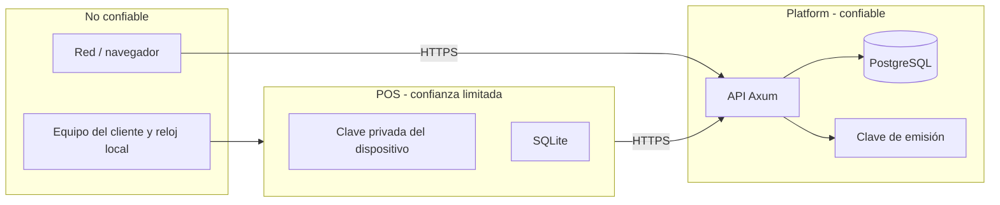

# G4.2 — Modelo de amenazas del enrolamiento POS ↔ Platform

- **Propósito:** identificar y priorizar amenazas STRIDE y abuso comercial del enrolamiento antes de implementarlo.
- **Estado:** PROPOSED — insumo para revisión del titular.
- **Fecha:** 2026-11-08.
- **Alcance:** enrolamiento, identidad de instalación, elegibilidad Trial, rehost y relación con licenciamiento. No evalúa la seguridad interna del POS más allá de lo necesario.
- **Decisiones:** las mitigaciones propuestas dependen de las decisiones D-A…D-J.
- **Dependencias:** ADR-0003 y matriz de decisiones.
- **Riesgos:** riesgos residuales por amenaza y §5.
- **Referencias:** §8.
- **Baseline Platform:** `f8823ad07fcd63dd5b5a17dd4cb11612736f2a22`.
- **Baseline POS:** `b3def1efb2863caf08fd525bac4e78db3ba223f7`.

## 1. Activos

| ID | Activo | Propietario | Confidencialidad | Integridad | Disponibilidad |
|---|---|---|---|---|---|
| A-01 | Cuenta comercial | Platform | Alta | Alta | Media |
| A-02 | Sesión comercial (`hiqnet_session`) | Platform | Alta | Alta | Media |
| A-03 | Organización | Platform | Media | Alta | Alta |
| A-04 | Membresías y roles | Platform | Media | Alta | Media |
| A-05 | Identidad de instalación (UUID + clave pública) | Platform/POS | Media | Alta | Alta |
| A-06 | Clave privada del dispositivo | POS | Crítica | Crítica | Media |
| A-07 | Clave privada de emisión Ed25519 | Platform | Crítica | Crítica | Alta |
| A-08 | Challenge de enrolamiento | Platform | Media | Alta | Media |
| A-09 | Elegibilidad/Trial | Platform | Media | Alta | Media |
| A-10 | Grant firmado | Platform/POS | Baja | Crítica | Alta |
| A-11 | SQLite local y datos del negocio | POS | Alta | Alta | Alta |
| A-12 | Auditoría PostgreSQL | Platform | Alta | Crítica | Alta |

## 2. Límites de confianza

- El equipo y su reloj **no** son confiables para decisiones de elegibilidad.
- La clave privada del dispositivo nunca cruza a Platform.
- La clave de emisión nunca sale de Platform.
- PostgreSQL es la fuente de verdad persistente.

## 3. Amenazas STRIDE

### 3.1 Spoofing (suplantación)

| Campo | T-01 Suplantación de organización |
|---|---|
| Activo | A-05, A-03 |
| Escenario | El cliente envía un `organization_id` ajeno al registrar su instalación. |
| Precondiciones | Sesión válida de cualquier cuenta o endpoint mal diseñado. |
| Impacto | Vinculación cross-tenant; fuga o secuestro de licencias. |
| Probabilidad | Media si la ruta acepta el UUID del cuerpo. |
| Severidad | Crítica |
| Mitigación | Organización derivada de la solicitud aprobada y de la membresía del actor; jamás del cuerpo del POS. Verificación SQL de `owner` activo. |
| Evidencia | Prueba HTTP cross-tenant con dos organizaciones y dos owners. |
| Riesgo residual | Bajo con la mitigación; requiere revisión de contrato. |

| Campo | T-02 Suplantación de instalación |
|---|---|
| Activo | A-05, A-10 |
| Escenario | Un atacante reutiliza el `installation_id` de otra instalación con su propia clave. |
| Precondiciones | Conocer el UUID ajeno. |
| Impacto | Confusión de identidad y posible reemplazo de clave. |
| Probabilidad | Media |
| Severidad | Alta |
| Mitigación | El UUID es solo un handle; la vinculación exige clave pública consistente. UUID ya vinculado con clave distinta → 409 y evento de seguridad. |
| Evidencia | Prueba de conflicto UUID/clave. |
| Riesgo residual | Bajo. |

### 3.2 Tampering (manipulación)

| Campo | T-03 Sustitución de clave pública |
|---|---|
| Activo | A-05, A-10 |
| Escenario | Un actor autorizado intenta reemplazar la clave de una instalación existente durante el enrolamiento. |
| Precondiciones | Sesión `owner` comprometida o error de flujo. |
| Impacto | Toma de control de la instalación; grants futuros a un dispositivo no legítimo. |
| Probabilidad | Baja/Media |
| Severidad | Alta |
| Mitigación | Rotación solo mediante operación explícita de re-enrolamiento con rehost auditado; nunca sobrescritura silenciosa. |
| Evidencia | Prueba de re-enrolamiento con clave nueva y auditoría. |
| Riesgo residual | Medio si la cuenta owner está comprometida. |

| Campo | T-04 Manipulación de grants en disco |
|---|---|
| Activo | A-10 |
| Escenario | El usuario edita `license_grant_json` o `license_signature_b64` en SQLite. |
| Precondiciones | Acceso local al archivo. |
| Impacto | Intento de elevar plan o vigencia. |
| Probabilidad | Media |
| Severidad | Alta |
| Mitigación | Verificación Ed25519 en Rust con clave pública embebida; estado derivado del grant verificado. Ya implementado en POS. |
| Evidencia | Pruebas existentes de payload manipulado y clave incorrecta. |
| Riesgo residual | Bajo; el binario y la clave pública deben protegerse. |

| Campo | T-05 Manipulación del reloj |
|---|---|
| Activo | A-09, A-10 |
| Escenario | El usuario atrasa el reloj para extender el Trial o un grant vencido. |
| Precondiciones | Control del sistema operativo y operación offline. |
| Impacto | Uso más allá de la fecha autorizada. |
| Probabilidad | Alta en equipos offline. |
| Severidad | Media |
| Mitigación | Fechas de emisión/validez fijadas por Platform; detección de retroceso al reconectar; grants con `issued_at`/`valid_until`. |
| Evidencia | Prueba de reloj fijo y reconciliación al reconectar. |
| Riesgo residual | **Alto e inevitable** en offline puro. Debe reconocerse comercialmente. |

| Campo | T-06 Restauración maliciosa de backup |
|---|---|
| Activo | A-09, A-11 |
| Escenario | Se restaura un SQLite antiguo para recuperar un Trial previo. |
| Precondiciones | Backup local accesible. |
| Impacto | Extensión del Trial. |
| Probabilidad | Media |
| Severidad | Media |
| Mitigación | El POS ya rechaza backups con identidad distinta y preserva el estado comercial vigente (`backup.rs`); el diseño no debe relajarlo. |
| Evidencia | Pruebas existentes de restauración y `pending_restore`. |
| Riesgo residual | Bajo mientras se preserve la política actual. |

### 3.3 Repudiation (repudio)

| Campo | T-07 Repudio de enrolamiento |
|---|---|
| Activo | A-12 |
| Escenario | Un owner niega haber autorizado una instalación. |
| Precondiciones | Falta de trazabilidad. |
| Impacto | Disputas comerciales y de soporte. |
| Probabilidad | Media |
| Severidad | Media |
| Mitigación | Auditoría append-only con actor, organización, instalación, clave (huella), fecha y resultado. |
| Evidencia | Prueba de evento `installation_enrolled` y trigger append-only. |
| Riesgo residual | Bajo. |

| Campo | T-08 Borrado o alteración de auditoría |
|---|---|
| Activo | A-12 |
| Escenario | Se intenta `UPDATE`/`DELETE` sobre eventos. |
| Precondiciones | Acceso SQL indebido. |
| Impacto | Pérdida de evidencia. |
| Probabilidad | Baja |
| Severidad | Alta |
| Mitigación | Trigger de inmutabilidad ya existente; mismas garantías para nuevos eventos. |
| Evidencia | Pruebas de trigger. |
| Riesgo residual | Bajo. |

### 3.4 Information disclosure (divulgación)

| Campo | T-09 Enumeración cross-tenant |
|---|---|
| Activo | A-03, A-05 |
| Escenario | Un miembro de A consulta instalaciones o membresías de B por UUID. |
| Precondiciones | Sesión válida. |
| Impacto | Confirmación de existencia de tenants ajenos. |
| Probabilidad | Media |
| Severidad | Media |
| Mitigación | Filtro SQL por membresía; 404 neutral; listados paginados sin filtros de cliente. |
| Evidencia | Pruebas cross-tenant de organizaciones/miembros y futuras de instalaciones. |
| Riesgo residual | Bajo. |

| Campo | T-10 Exposición de clave privada o secretos |
|---|---|
| Activo | A-06, A-07 |
| Escenario | La clave privada del dispositivo se registra, se envía o se incluye en un backup público. |
| Precondiciones | Error de implementación. |
| Impacto | Suplantación del dispositivo o de emisión. |
| Probabilidad | Baja |
| Severidad | Crítica |
| Mitigación | La clave privada nunca sale del POS; Platform solo recibe pública; escaneo de secretos y revisión de logs. |
| Evidencia | `check_repository.py`, revisión de contratos, pruebas de que el body no contiene privada. |
| Riesgo residual | Bajo. |

### 3.5 Denial of service

| Campo | T-11 Registro masivo automatizado |
|---|---|
| Activo | A-01, A-05, A-09 |
| Escenario | Bots crean solicitudes de enrolamiento o cuentas para agotar recursos o sembrar Trials. |
| Precondiciones | Endpoint público y sin límites. |
| Impacto | Consumo de CPU/DB y abuso comercial. |
| Probabilidad | Alta |
| Severidad | Media |
| Mitigación | Rate limit por IP y por recurso, expiración corta, tamaño máximo de payload, verificación de correo como decisión pendiente. |
| Evidencia | Pruebas de 429 y límites. |
| Riesgo residual | Medio. |

| Campo | T-12 Agotamiento por challenges |
|---|---|
| Activo | A-08, A-12 |
| Escenario | Se generan challenges sin completar para llenar la tabla. |
| Precondiciones | Endpoint de inicio accesible. |
| Impacto | Crecimiento y presión de limpieza. |
| Probabilidad | Media |
| Severidad | Baja/Media |
| Mitigación | Expiración, limpieza periódica, cuota por IP y tamaño acotado. |
| Evidencia | Prueba de expiración y job de limpieza. |
| Riesgo residual | Bajo. |

### 3.6 Elevation of privilege

| Campo | T-13 `admin`/`member` enrola |
|---|---|
| Activo | A-04, A-05 |
| Escenario | Un rol sin autoridad crea instalaciones. |
| Precondiciones | Sesión válida con rol no owner. |
| Impacto | Dispositivos no autorizados. |
| Probabilidad | Media si la autorización es incorrecta. |
| Severidad | Alta |
| Mitigación | Comprobación de `owner` activo en SQL antes de aprobar; 403 si pertenece a la org, 404 si es ajena. |
| Evidencia | Pruebas por rol. |
| Riesgo residual | Bajo. |

| Campo | T-14 Confusión DEV/comercial |
|---|---|
| Activo | A-03, A-05 |
| Escenario | Se usa el token administrativo DEV para enrolar o se expone una ruta DEV en producción. |
| Precondiciones | Configuración incorrecta. |
| Impacto | Registro arbitrario sin membresía. |
| Probabilidad | Baja |
| Severidad | Alta |
| Mitigación | Rutas comerciales solo con `commercialSession`; DEV deshabilitado fuera de desarrollo; auditoría y pruebas de seguridad del contrato. |
| Evidencia | Matriz de endpoints y prueba de que DEV no acepta cookies ni viceversa. |
| Riesgo residual | Bajo. |

### 3.7 Replay y carreras

| Campo | T-15 Replay de challenge |
|---|---|
| Activo | A-08, A-05 |
| Escenario | Se reenvía una prueba válida para enrolar otra instalación. |
| Precondiciones | Capturar el tráfico o el body. |
| Impacto | Enrolamiento no autorizado. |
| Probabilidad | Media sin consumo único. |
| Severidad | Alta |
| Mitigación | Nonce ligado a la solicitud, expiración corta, `consumed_at` único y transacción de consumo. |
| Evidencia | Prueba de segundo uso → 409/410. |
| Riesgo residual | Bajo con HTTPS. |

| Campo | T-16 Carrera de aprobación/consumo |
|---|---|
| Activo | A-08, A-05 |
| Escenario | Dos pruebas concurrentes intentan completar la misma solicitud. |
| Precondiciones | Solicitud aprobada. |
| Impacto | Doble vinculación o estado inconsistente. |
| Probabilidad | Media |
| Severidad | Alta |
| Mitigación | `UPDATE ... WHERE status='approved' AND consumed_at IS NULL` o `FOR UPDATE`, con auditoría en la misma transacción. |
| Evidencia | Prueba con dos conexiones. |
| Riesgo residual | Bajo. |

### 3.8 Abuso comercial

| Campo | T-17 Reinicio del Trial por reinstalación |
|---|---|
| Activo | A-09 |
| Escenario | El usuario borra archivos y genera una instalación nueva para repetir 30 días. |
| Precondiciones | Trial atado solo a instalación. |
| Impacto | Pérdida de ingresos y abuso. |
| Probabilidad | Alta |
| Severidad | Alta |
| Mitigación | Elegibilidad persistente por organización (y controles de cuenta pendientes); Trial consumido no se reabre. |
| Evidencia | Prueba de segunda instalación en la misma organización → sin Trial nuevo. |
| Riesgo residual | Medio-alto con organizaciones/cuentas nuevas (ver T-18). |

| Campo | T-18 Múltiples cuentas/organizaciones |
|---|---|
| Activo | A-09, A-01 |
| Escenario | Una persona crea varias cuentas y organizaciones para repetir Trials. |
| Precondiciones | Registro sin verificación fuerte. |
| Impacto | Abuso sistemático. |
| Probabilidad | Alta |
| Severidad | Alta |
| Mitigación | Verificación de correo/identidad, señales de abuso, revisión manual y límites operativos aprobados. |
| Evidencia | Pruebas de flujo; el abuso real requiere analítica operativa. |
| Riesgo residual | **Alto**; no es identificable con certeza. |

| Campo | T-19 Clonación de instalación |
|---|---|
| Activo | A-05, A-06, A-10 |
| Escenario | Dos equipos usan la misma clave/instalación. Se distinguen tres casos: (1) misma clave con distinto `installation_id`; (2) misma clave y mismo `installation_id`; (3) clonación con ambos equipos offline. |
| Precondiciones | Copia de clave privada o del perfil. |
| Impacto | Uso simultáneo no autorizado. |
| Probabilidad | Media |
| Severidad | Alta |
| Mitigación | Caso 1: índice único de fingerprint activo → 409 y evento. Caso 2: no es detectable criptográficamente en el enrolamiento; se usan `generation`, registro de conexiones/renovaciones, anomalías al reconectar y revisión operativa. Caso 3: detección diferida; rehost/revocación como respuesta. TPM opcional. |
| Evidencia | Caso 1 automatizable; casos 2 y 3 requieren prueba física/E2E y aceptación de límite. |
| Riesgo residual | **Alto** en casos 2 y 3; no se promete identificación física infalible. |

| Campo | T-20 Rehost malicioso |
|---|---|
| Activo | A-05, A-09 |
| Escenario | Un owner comprometido reasigna instalaciones para beneficiar a otro tenant. |
| Precondiciones | Sesión owner. |
| Impacto | Licencias a favor de terceros. |
| Probabilidad | Baja |
| Severidad | Alta |
| Mitigación | Rehost explícito, auditado, con historial y revisión si se aprueba un umbral. |
| Evidencia | Pruebas de rehost y auditoría. |
| Riesgo residual | Medio. |

| Campo | T-21 Confusión de tenant por UUID |
|---|---|
| Activo | A-03, A-05 |
| Escenario | Se intenta mover una instalación a otra organización cambiando el UUID del cuerpo. |
| Precondiciones | Endpoint que acepte organización del cliente. |
| Impacto | Cross-tenant. |
| Probabilidad | Media |
| Severidad | Crítica |
| Mitigación | Organización inmutable tras vinculación; cambio solo por rehost explícito con autorización y auditoría. |
| Evidencia | Prueba de intento de cambio con 409. |
| Riesgo residual | Bajo. |

| Campo | T-22 Robo o uso indebido de sesión comercial |
|---|---|
| Activo | A-02, A-05 |
| Escenario | Un tercero obtiene la cookie o fuerza al owner a aprobar un enrolamiento (CSRF). |
| Precondiciones | XSS/Malware, cookie accesible o ausencia de validación de `Origin`. |
| Impacto | Enrolamiento no autorizado o rehost. |
| Probabilidad | Media |
| Severidad | Alta |
| Mitigación | Cookie `HttpOnly`/`Secure`/`SameSite`, `Origin` exacto en mutaciones, sesión rotativa y auditoría del actor. |
| Evidencia | Pruebas de CSRF y de cookie inválida. |
| Riesgo residual | Medio si el equipo del owner está comprometido. |

| Campo | T-23 MITM en el canal de enrolamiento |
|---|---|
| Activo | A-08, A-05, A-10 |
| Escenario | Un intermediario altera la solicitud, la prueba o el grant. |
| Precondiciones | Red hostil o TLS mal validado. |
| Impacto | Suplantación o entrega de un grant ajeno. |
| Probabilidad | Baja con TLS correcto. |
| Severidad | Alta |
| Mitigación | TLS obligatorio con validación estricta, firma de la prueba y firma del grant; no aceptar HTTP. |
| Evidencia | Configuración TLS y pruebas de firma. |
| Riesgo residual | Bajo. |

| Campo | T-24 Revocación concurrente con enrolamiento |
|---|---|
| Activo | A-04, A-05 |
| Escenario | Se revoca la membresía o la instalación mientras se completa un enrolamiento. |
| Precondiciones | Carrera entre transacciones. |
| Impacto | Vinculación con un actor que ya perdió autoridad. |
| Probabilidad | Media |
| Severidad | Alta |
| Mitigación | Revalidar organización activa, cuenta activa, membresía activa y rol `owner` vigente **después** de bloquear solicitud y organización, dentro de la misma transacción que consume la prueba. Si la revocación se confirmó antes de la relectura, el binding se rechaza (409 neutral) y se registra `authorization_revoked_during_proof`. |
| Evidencia | Prueba concurrente de revocación y proof con dos conexiones; orden de bloqueos `request → organization`. |
| Riesgo residual | Bajo. |

| Campo | T-25 Secretos bearer persistidos en la respuesta idempotente |
|---|---|
| Activo | A-08, A-05 |
| Escenario | `device_code`, `user_code` o `nonce` quedan guardados en `idempotency_record.response_body` y un reintento o una lectura de base los recupera. |
| Precondiciones | Diseño que persiste la respuesta 201 completa. |
| Impacto | Reutilización de códigos de enrolamiento y secuestro de la vinculación. |
| Probabilidad | Media sin control explícito. |
| Severidad | Alta |
| Mitigación | Entrega única; `response_body` nulo cuando `secrets_delivered = true`; `CHECK` en base; reintento devuelve `409 enrollment_restart_required`. |
| Evidencia | Prueba de que la tabla no contiene los códigos y de que el reintento no los revela. |
| Riesgo residual | Bajo con la política de entrega única. |

## 4. Prioridad

| Prioridad | Amenazas |
|---|---|
| Crítica | T-01, T-10, T-21 |
| Alta | T-02, T-03, T-04, T-05 (residual), T-13, T-14, T-15, T-16, T-17, T-18, T-19, T-22, T-23, T-24, T-25 |
| Media | T-06, T-07, T-08, T-09, T-11, T-20 |
| Baja | T-12 |

## 5. Propiedades verificables vs. físicas

| Propiedad | Verificación |
|---|---|
| Aislamiento cross-tenant | Automática (HTTP + PostgreSQL). |
| Consumo único de challenge | Automática (concurrencia). |
| Replay e idempotencia | Automática. |
| Conflicto de clave/instalación | Automática para clave con distinta identidad; no para misma clave+id. |
| Secretos no persistidos en idempotencia | Automática (consulta SQL + reintento HTTP). |
| Revalidación de owner en proof | Automática con dos conexiones. |
| Rollback de auditoría | Automática. |
| Manipulación de grant | Automática (POS). |
| Clonación real con copia de perfil | Requiere prueba física/E2E. |
| Manipulación del reloj y offline | Requiere prueba física y aceptación de riesgo. |
| Restauración de backup en hardware distinto | Requiere prueba física/E2E. |

## 6. Riesgos críticos que deben resolverse antes de implementar

1. **Tenant desde el cliente (T-01/T-21):** el contrato debe impedir que el POS fije la organización.
2. **Identidad sin posesión (T-02/T-15):** sin challenge firmado no hay enrolamiento seguro.
3. **Trial por instalación (T-17):** sin elegibilidad persistente, el Trial es trivial de reiniciar.
4. **Clave de emisión (T-10):** debe permanecer fuera del POS y de logs.
5. **Confusión DEV (T-14):** las rutas DEV no pueden servir al flujo comercial.

## 7. Dependencias y decisiones asociadas

- Depende de [ADR-0003](adr-0003-installation-enrollment.md) y de las decisiones pendientes D-A…D-J de la [matriz](g42-decisions-matrix.md).
- Las mitigaciones marcadas como PENDIENTES no deben implementarse hasta aprobación.
- Los riesgos residuales T-05, T-18 y T-19 requieren aceptación explícita del titular.

## 8. Referencias

- [ADR-0003 — Identidad y enrolamiento](adr-0003-installation-enrollment.md)
- [Protocolo de enrolamiento](g42-enrollment-protocol.md)
- [Modelo de datos](g42-data-model.md)
- [Política de Trial y rehost](g42-trial-eligibility-rehost-policy.md)
- [Matriz de decisiones](g42-decisions-matrix.md)
- POS `docs/01-architecture/decisions/ADR-004-licensing.md` y `backend-rust/crates/pos-storage-sqlite/src/backup.rs` (solo lectura).
