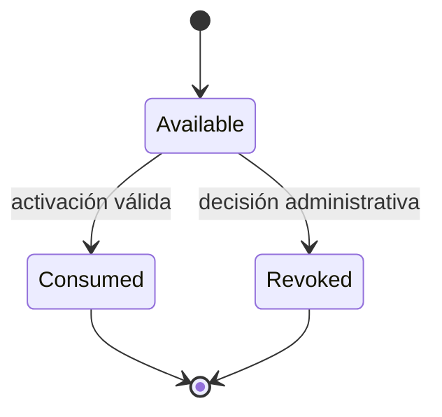

# G4.2 — Política propuesta de elegibilidad Trial, rehost y recuperación

- **Propósito:** proponer la autoridad del Trial y el tratamiento de reinstalación, rehost, clonación y offline.
- **Estado:** PROPOSED — requiere aprobación del titular antes de implementar.
- **Fecha:** 2026-11-08.
- **Alcance:** decisión central de Trial, reinstalaciones, backup, cambio de hardware, clonación, cuentas múltiples, offline y reloj.
- **Decisiones:** §2, §4 y §8; pendientes en la matriz.
- **Dependencias:** ADR-0003, modelo de datos y estado actual del POS.
- **Riesgos:** §9 y §11.
- **Referencias:** §12.

## 1. Principios

1. Evalúa el Trial una autoridad persistente, no el cliente.
2. El Trial aprobado dura 30 días; no existe plan gratuito permanente.
3. La elegibilidad no depende de memoria ni del reloj del equipo.
4. Los límites no aprobados no se inventan ni se codifican.
5. Un dispositivo offline bajo control del usuario impone límites inevitables.

## 2. Autoridades de elegibilidad evaluadas

| Autoridad | Ventaja | Riesgo | Veredicto |
|---|---|---|---|
| Por instalación | Simple; coincide con el esquema actual. | Reinicio trivial con UUID nuevo. | Insuficiente sola. |
| Por cuenta | Difícil de repetir con la misma cuenta. | Castiga a dueños con varios negocios legítimos. | Complementaria. |
| Por organización | Unidad comercial; reinstall no reinicia. | Abuso con organizaciones nuevas. | **Principal recomendada.** |
| Por identidad criptográfica | Detecta clones. | Clave nueva evade. | Complementaria. |
| Combinación persistente | Mayor robustez. | Complejidad y falsos positivos. | **Objetivo**: organización + señales de cuenta. |
| Historial central | Auditable y explicable. | Requiere operación. | Necesario. |

**Recomendación:** elegibilidad **por organización** como autoridad principal, con `first_seen_account_id` y señales de cuenta como controles secundarios. La regla exacta “una cuenta = un Trial” queda PENDIENTE porque afecta a clientes con múltiples negocios.

## 3. Estados propuestos

- `available`: la organización nunca consumió Trial.
- `consumed`: Trial iniciado; `started_at`/`ends_at` fijados por Platform.
- `revoked`: denegado por abuso o decisión administrativa.
- `consumed` y `revoked` son terminales.
- Renovaciones, upgrades y periodos de gracia pertenecen a licenciamiento, no a este estado.

## 4. Regla de activación propuesta

1. El actor debe ser `owner` activo de la organización (o el rol que se apruebe).
2. La organización debe estar `active` y tener una instalación vinculada.
3. `trial_entitlement.status = 'available'`.
4. Platform fija `started_at` con su reloj y `ends_at = started_at + 30 días`.
5. La operación es idempotente: repetir devuelve el mismo Trial; nunca reinicia.
6. Se audita `trial_activated` o `trial_denied` con motivo.

La activación no emite todavía un grant comercial; prepara el estado para G4.2-C/D.

## 5. Escenarios

### Escenario 1 — Reinstalación legítima

- **Situación:** el cliente formatea el equipo y reinstala el POS.
- **Comportamiento propuesto:** el Trial no se reinicia. Si la organización ya consumió, la instalación nueva queda sin Trial nuevo.
- **Recuperación:** si el cliente conserva su clave privada y `installation_id`, puede re-vincular la misma identidad; si no, se crea una identidad nueva y se aplica rehost.
- **Límite:** sin clave conservada no hay prueba de continuidad; la organización es la que evita el reinicio.

### Escenario 2 — Restauración de backup

- **Situación:** se restaura un SQLite anterior.
- **Comportamiento propuesto:** se conserva la política actual del POS: solo se restaura sobre la misma identidad y organización, y el estado comercial vigente se preserva. Un Trial antiguo no se extiende.
- **Platform:** el estado del servidor prevalece; un backup más antiguo no reabre `consumed`.
- **Límite:** un backup completo del perfil, incluida la clave privada, puede replicar la identidad; se detecta al coincidir clave activa en dos instalaciones.

### Escenario 3 — UUID nuevo

- **Situación:** se borran los archivos locales y se genera una identidad nueva.
- **Comportamiento propuesto:** la organización ya consumió Trial; la nueva instalación no obtiene otro.
- **Abuso con organización nueva:** requiere crear otra organización/cuenta; ver Escenario 6.

### Escenario 4 — Cambio de hardware

- **Situación:** el cliente reemplaza su PC.
- **Comportamiento propuesto:** rehost autorizado: el `owner` vincula la nueva instalación; el binding anterior se revoca con motivo y se audita `installation_rehosted`.
- **Datos:** el negocio restaura su SQLite; si la identidad cambia, el flujo de backup actual exige revisión (decisión G4.2-D).
- **Límite:** no se inventa un número máximo de rehosts; se recomienda revisión manual si se aprueba un umbral operativo.

### Escenario 5 — Clonación

- **Situación:** dos equipos usan la misma identidad/clave.
- **Detección propuesta por caso:**
  - Misma clave con distinto `installation_id`: el índice único de fingerprint activo produce `409` y `duplicate_key`.
  - Misma clave y mismo `installation_id`: ambos equipos son criptográficamente indistinguibles; no se promete detección en el enrolamiento.
  - Clonación offline: no observable en tiempo real; se detecta al reconectar por generaciones, conexiones/renovaciones anómalas y revisión operativa.
- **Respuesta:** revocar la identidad comprometida, cerrar el binding y exigir rehost.
- **Límite:** sin hardware seguro o señales adicionales no hay identificación física infalible.

### Escenario 6 — Múltiples cuentas

- **Situación:** una persona crea varias cuentas/organizaciones para repetir el Trial.
- **Propuesta:** señales de abuso (`first_seen_account_id`, dominio de correo, IP hash, patrones temporales), verificación de correo y revisión operativa. No se afirma identificación personal infalible.
- **Decisión pendiente:** si se aplica “un Trial por cuenta” además de por organización.
- **Riesgo residual:** alto; debe aceptarse comercialmente o reforzarse con verificación de identidad.

### Escenario 7 — Desconexión prolongada

- **Situación:** una instalación autorizada permanece offline.
- **Propuesta:** opera con el grant vigente hasta `valid_until`; al reconectar reporta estado y reconcilia. No hay renovación local.
- **Límite:** la duración de `valid_until`, la gracia y el lease están PENDIENTES; no se fijan aquí.

### Escenario 8 — Reloj manipulado

- **Situación:** el usuario cambia la fecha del sistema.
- **Propuesta:** Platform usa su reloj para emitir y decidir; el POS usa `issued_at`/`valid_until` del grant; al reconectar se detectan retrocesos anómalos y se registran.
- **Límite:** en offline puro, el usuario controla el reloj. No se promete resistencia absoluta; se documenta como riesgo aceptado o se mitiga con hardware/atestación si el mercado lo exige.

## 6. Rehost propuesto

| Aspecto | Propuesta |
|---|---|
| Quién | `owner` activo (decisión A). |
| Cómo | Enrolamiento de la nueva instalación + cierre del binding anterior (`revoked_at`, `revoke_reason`). |
| Historial | Un único binding activo por `installation_id` (`UNIQUE` parcial); las filas históricas no se borran ni se reescriben. |
| Organización | `installation.organization_id` es propietaria permanente; el binding se valida con FK compuesta. |
| Auditoría | `installation_rehosted` con actor, organización, instalación antigua/nueva y motivo. |
| Límite numérico | **No definido**; PENDIENTE. |
| Revisión manual | Opcional si se aprueba un umbral operativo. |
| Clave anterior | Se retira (`retired_at`) e incrementa `generation`; no se reutiliza. |
| Tenant | Inmutable; una transferencia legítima exige procedimiento administrativo explícito y probablemente nueva identidad. |

## 7. Recuperación sin hardware seguro

- Clave privada en archivo con permisos restrictivos cuando no hay keystore.
- El usuario puede exportar/importar la identidad solo mediante un flujo explícito, nunca automático.
- Si se pierde la clave, el owner puede re-enrolar; se trata como rehost.
- La recuperación no reinicia el Trial.
- El backup del POS no debe incluir la clave privada en claro por defecto; PENDIENTE de decisión.

## 8. Compatibilidad con el Trial local actual del POS

Situación actual verificada en POS 0.1.0:

- `bootstrap` crea `CommercialState::new_trial(InstallationId::new(), ...)` sin Platform.
- `local_installation_state` conserva `installation_id`, `trial_started_at` y `valid_until`.
- La restauración de backup preserva el estado comercial vigente y rechaza otra identidad/organización.

Riesgo: mientras el bootstrap local siga concediendo 30 días, una reinstalación limpia reinicia el Trial con independencia de Platform.

Opciones:

| Opción | Efecto | Riesgo |
|---|---|---|
| A. Mantener Trial local y registrar `legacy_local` al conectar | No rompe instalaciones existentes. | Reinstalación limpia sigue reiniciando hasta G4.2-D. |
| B. Exigir activación online desde la primera versión nueva | Cierra el reinicio. | Requiere Internet en el primer arranque; cambia UX. |
| C. Trial local provisional + activación server obligatoria antes de 30 días | Equilibrio. | Complejidad de reconciliación. |

**Recomendación:** C para versiones nuevas, A para instalaciones existentes con marca `legacy_local` de una sola vez. La decisión definitiva queda PENDIENTE y no se implementa en G4.2-A.

## 9. Límites explícitos

- No se impide absolutamente la clonación ni la manipulación del reloj en un equipo offline controlado por el usuario.
- No se identifica con certeza a una persona detrás de varias cuentas.
- No se define un número de reinstalaciones, rehosts, días de gracia ni dispositivos por plan.
- Cualquier límite futuro requiere decisión documentada y no puede presentarse como ya aprobado.

## 10. Criterios de aceptación de la política (futura implementación)

- Reinstalar en la misma organización no concede otro Trial.
- Restaurar un backup no extiende el Trial.
- Un rehost autorizado queda auditado y no reinicia el Trial.
- Una clave duplicada con distinto `installation_id` genera conflicto y evento; el mismo `installation_id` no es distinguible y se documenta como límite.
- Repetir la activación es idempotente.
- El estado es consultable y explicable para soporte.

## 11. Dependencias y riesgos

- **Depende de:** aprobación de D-C (autoridad) y D-D (Trial local heredado).
- **Riesgo principal:** que el Trial local del POS siga reiniciándose hasta que G4.2-D cambie el bootstrap.
- **Riesgo comercial:** bloquear negocios legítimos con varios locales si se adopta “un Trial por cuenta” sin revisión.
- **Riesgo residual aceptado:** abuso con cuentas/organizaciones nuevas mientras no exista verificación de identidad.

## 12. Referencias

- [ADR-0003](adr-0003-installation-enrollment.md)
- [Modelo de amenazas](g42-enrollment-threat-model.md)
- POS `backend-rust/crates/pos-core/src/entitlements.rs`, `pos-application/src/service.rs` (bootstrap) y `pos-storage-sqlite/src/backup.rs` (solo lectura).
