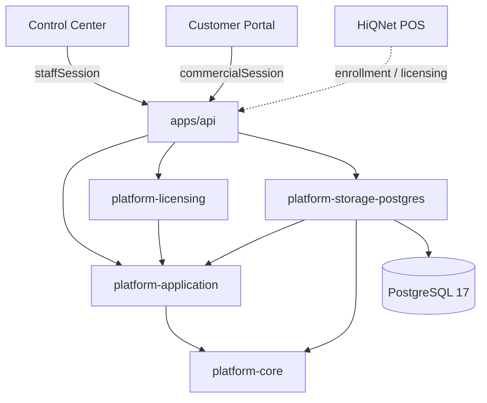

# HiQNet Platform — Arquitectura rectora

**Estado:** ACCEPTED — ratificado en Fase 1 (2026-11-09)
**Versión objetivo:** Beta 0.1.0
**Relacionado:** [Control Center](control-center.md) · [Roadmap](control-center-roadmap.md) · [ADR-0004](adr-0004-control-center-boundaries.md) · [ADR-0006](adr-0006-staff-rbac.md) · [ADR-0007](adr-0007-product-project-model.md) · [ADR-0011](adr-0011-commercial-domain.md) · [Backlog Beta](../02-development/platform-beta-backlog.md) · [Seguridad Beta](../02-development/platform-beta-security.md)

> Este documento ratifica la arquitectura multiproducto de HiQNet Platform para la Beta 0.1.0. No reescribe C0–C5: conserva sus ADR y contratos. Donde una decisión histórica sea más restrictiva o específica de POS, este documento y ADR-0011 prevalecen para el alcance Beta.

## 1. Misión y alcance

HiQNet Platform es la infraestructura central de administración comercial y de clientes para los productos HiQNet.

La Beta 0.1.0 debe entregar una **plataforma administrativa web funcional, segura, documentada y estable**. No debe convertirse en una suite de gestión del desarrollo ni en un sistema de facturación.

HiQNet POS es el **primer consumidor**, nunca una dependencia estructural del núcleo.

## 2. Restricción adoptada: Platform es web

Platform es una aplicación **100 % web**.

- Se conservan Rust, Axum, PostgreSQL, SQLx, React, TypeScript, OpenAPI 3.1, HTTPS y Playwright.
- No se introduce Tauri, Electron, React Native, Capacitor ni empaquetado nativo.
- No se generan instaladores Windows, APK, aplicaciones iOS, AppImage ni paquetes de escritorio para Platform.
- No se exige PWA instalable ni modo offline web para la Beta.
- Control Center y Customer Portal deben ser responsive en 390, 768, 1024, 1440 y 1920 px.

HiQNet POS conserva su arquitectura propia (Rust, React, Tauri 2, SQLite, local-first, Windows/Linux/Android). La integración es por APIs; Platform no adquiere la autoridad operativa del POS.

## 3. Superficies

| Superficie | Aplicación | Identidad | API | Autoridad |
|---|---|---|---|---|
| Control Center | `apps/control-center` | `staff_account` · cookie `hiqnet_staff_session` | `/api/v1/control/*` | Operación interna y administración |
| Customer Portal | `apps/portal` (PR #12/#13, pendiente de integración) | `commercial_account` · cookie `hiqnet_session` | `/api/v1/*` | Consistencia comercial del tenant |
| Core Services | `apps/api` + `crates/*` | Según superficie | Contratos OpenAPI | Dominio, persistencia y seguridad |
| POS / Device | `hiqnet-pos` (repositorio externo) | Identidad local POS · clave Ed25519 | Enrolamiento y licencias | Operación local y prueba de posesión |

Reglas:

1. El Control Center no reutiliza endpoints comerciales para vistas globales.
2. El Customer Portal no obtiene autoridad staff.
3. Una sesión comercial no concede privilegios administrativos.
4. Una instalación no representa un usuario.
5. `devAdminToken` es LEGACY/DEV y no es un mecanismo de producción.
6. El Customer Portal expone un read-only comercial por organización (`/api/v1/organizations/{id}/products`) con `commercialSession`; no reutiliza `/control` ni muestra datos de otros clientes.

## 4. Monolito modular

Se mantiene un monolito modular:

Reglas de capas:

- `platform-core`: dominio e invariantes; sin SQL, sin Axum.
- `platform-application`: casos de uso, puertos y autorización de aplicación; sin SQL.
- `platform-storage-postgres`: SQL, transacciones y adaptadores.
- `platform-licensing`: firma y compatibilidad del documento de licencia.
- `apps/api`: composición HTTP, DTOs, OpenAPI y handlers.
- Frontends: HTTP; sin lógica de autoridad.

No se introducen microservicios, microfrontends, plugins dinámicos ni un bus genérico sin necesidad demostrable.

## 5. Independencia de producto

- **Product** es un dato, no un enum.
- El catálogo de **planes** es específico de cada producto. Los planes `trial`, `local`, `pro` y `enterprise` son datos iniciales de POS, no valores universales.
- Las capacidades de producto (`installations`, `licensing`, `enrollment`, `sync`, etc.) son **opcionales**. Platform no obliga a todos los productos a tener instalaciones, licencias offline ni enrolamiento.
- El núcleo no contiene reglas de POS. Las reglas específicas pertenecen al producto o a su integración.
- La Beta validará las capacidades genéricas con un **segundo producto sintético** distinto de POS.
- El Control Center de Beta usa módulos genéricos y capability-gated por staff. El renderizado de módulos por producto queda como extensión futura; no es requisito de Beta.

## 6. Identidades

| Identidad | Entidad | Superficie | Autoridad |
|---|---|---|---|
| Staff | `staff_account`, `staff_role_assignment` | Control Center | Operación interna |
| Comercial | `commercial_account`, `organization_membership` | Customer Portal | Organización cliente |
| Dispositivo | `installation_identity` (Ed25519) | Enrolamiento | Posesión de clave |
| Local POS | identidad local POS | POS | Operación local |

Son ejes separados y no intercambiables. Las cookies, sesiones, nombres de ruta y esquemas OpenAPI son distintos.

## 7. Vocabulario comercial

| Concepto | Definición | Autoridad | Persistencia actual | Estado Beta |
|---|---|---|---|---|
| **Product** | Oferta o aplicación reusable de HiQNet | Catálogo staff | `product` (C2) | Implementado |
| **Project** | Unidad técnica/operativa asociada 0..1 a Product | Registro staff | `project` (C2) | Implementado |
| **Organization** | Tenant cliente | Dominio comercial | `organization` (C2) | Implementado |
| **OrganizationProduct** | Habilitación de un producto para una organización | Operación administrativa | `organization_product` (C4/B4) | Implementado: lectura y mutaciones `active|inactive` sin DELETE |
| **Plan** | Oferta comercial de un producto: nombre, features y límites | Catálogo staff | No existe tabla; `PlanName` hardcodeado (POS) | **Desarrollar** |
| **Subscription** | Contrato comercial organización–producto–plan con vigencia y estado | Operación administrativa | No existe | **Desarrollar** |
| **Entitlement** | Derecho efectivo derivado de una suscripción vigente | Resolución de dominio | `organization_product.entitlements` JSONB (no autoridad) | **Desarrollar resolver** |
| **License** | Documento firmado que representa derechos para una instalación | Platform (Ed25519 v1) | `issued_license` | Técnico existente; emisión DEV-only |
| **Installation** | Registro lógico de una instancia desplegada | Producto / enrolamiento | `installation` (C1/C4/C5) | Implementado; opcional por producto |

Reglas de frontera:

- `OrganizationProduct` no es una suscripción.
- `Plan` no es precio ni factura.
- `Entitlement` no es permiso staff.
- `License` no es suscripción; es una representación técnica firmada.
- Una instalación no es un usuario ni una licencia.
- `organization_product.status` habilita un producto; no concede derechos comerciales por sí solo.
- `organization_product.entitlements` es metadata extensible en C4; en Beta la autoridad comercial es `Subscription + Plan` y el resolver de entitlements.
- Capabilities comerciales: planes → `products.read`/`products.manage`; suscripciones/entitlements → `subscriptions.read`/`subscriptions.manage`; OrganizationProduct → `organizations.manage`.

El contrato detallado está en [ADR-0011](adr-0011-commercial-domain.md).

## 8. Fronteras de seguridad

- Autorización en backend; el frontend sólo refleja capabilities.
- Deny by default; `403` neutral; `404` neutral para recursos inexistentes o ajenos.
- Aislamiento de tenant en SQL y constraints.
- Auditoría staff transaccional para mutaciones administrativas.
- Eventos de seguridad append-only.
- Secretos, claves privadas, tokens y hashes de sesión nunca se exponen.
- Endpoints DEV no son mecanismos de producción.
- HTTPS y cookies seguras en producción; `SameSite` estricto para staff.
- La matriz de riesgos y las condiciones de seguridad de Beta están en [Seguridad Beta](../02-development/platform-beta-security.md).

## 9. API y contratos

- OpenAPI 3.1 como contrato canónico.
- Tres security schemes: `staffSession`, `commercialSession`, `devAdminToken` (legacy/DEV).
- Errores normalizados: `400 validation_error`, `401 unauthorized`, `403 forbidden`, `404 not_found`, `409 conflict`, `503 storage_error`.
- Paginación keyset, cursores opacos y límites acotados.
- Cambios aditivos; no se rompen contratos existentes sin estrategia de compatibilidad.
- Nuevas rutas staff bajo `/api/v1/control/*`.
- `operation_id` estable y snapshot OpenAPI actualizado en el mismo PR.

## 10. Persistencia y migraciones

- Migraciones incrementales e inmutables: `0001–0009` no se reescriben.
- Orden previsto:
  - `0010`: índices de lectura de C6 (diseñados en ADR-0010 / PR #22).
  - `0011+`: dominio comercial (planes, suscripciones, historial, entitlements).
- Si negocio exige el dominio comercial antes que C6, la migración de C6 se renumera y se actualiza ADR-0010 **antes** de implementar. No se ejecutan ambas numeraciones en paralelo.
- No se crean tablas antes de ratificar el contrato de dominio.
- No se eliminan índices ni columnas existentes en Beta.
- Versionado Beta: `platform-v0.1.0-beta.N` (prerelease SemVer). Ver [Backlog Beta](../02-development/platform-beta-backlog.md) §11. No se crea tag ni release en Fase 1.

## 11. Estado actual

- C1–C5: implementados, integrados y validados en `main`.
- C6: contrato aprobado en rama (PR #22, pendiente de merge); implementación C6.1–C6.4 pendiente.
- Customer Portal: implementado en PR #12/#13; PR #12 en conflicto con `main` por workspace/CI.
- Dominio comercial: planes, suscripciones y entitlements pendientes.
- Deuda de acoplamiento: `PlanName`/`FeatureKey` siguen en `platform-core` hasta B6; se conservan por compatibilidad de licencia y se usarán como seed de `pos`, no como catálogo universal.
- OrganizationProduct: lectura implementada; mutación pendiente.
- Licenciamiento: firma Ed25519 v1 y `issued_license`; emisión DEV-only.
- Sin pagos, facturación, C7, sync cloud ni apps nativas.

## 12. No objetivos de Platform Beta

- Pagos automáticos, checkout, cobros, reintentos, conciliación, facturación fiscal, CFDI.
- Suscripciones con prorrateo, cupones o trials automáticos.
- Environments, releases, deployments y administración de repositorios (C7).
- Sincronización cloud.
- Terminal remoto, SQL remoto, filesystem, impersonación de clientes o comandos arbitrarios.
- SIEM, risk score, severity engine, geolocation, device reputation.
- Incident management y respuesta automática.
- Detección fiable de clones.
- Aplicaciones nativas o PWA offline.
- Microservicios, microfrontends o plugins dinámicos.

## 13. Decisiones propuestas para ratificación

| ID | Decisión |
|---|---|
| D-BETA-ARCH-01 | Platform es 100 % web y responsive; sin tecnologías nativas. |
| D-BETA-ARCH-02 | Monolito modular con capas core → application → storage. |
| D-BETA-ARCH-03 | Control Center, Customer Portal y Core Services son superficies separadas por identidad, API y autoridad. |
| D-BETA-ARCH-04 | Product es dato; planes son por producto; POS no define el catálogo universal. |
| D-BETA-ARCH-05 | Instalaciones, enrolamiento y licencias son capacidades opcionales por producto. |
| D-BETA-ARCH-06 | OrganizationProduct, Subscription, Entitlement, License e Installation son conceptos distintos. |
| D-BETA-ARCH-07 | El dominio comercial se ratifica en ADR-0011 y se implementa después de C6.1 o con renumeración explícita. |
| D-BETA-ARCH-08 | La Beta se valida con un segundo producto sintético distinto de POS. |
| D-BETA-ARCH-09 | Los endpoints DEV no son mecanismos de producción. |
| D-BETA-ARCH-10 | El alcance de Beta está cerrado en el backlog; P2/P3 no se promueven sin demostrar bloqueo. |

## 14. Consecuencias

- C1–C5 se conservan sin reescritura.
- El siguiente incremento documental/implementación es el backlog Beta.
- El dominio comercial requiere ADR-0011, migración y UI, pero no cambia los contratos C1–C5.
- La integración del Portal y C6.1 se ejecutan antes de la migración comercial para reducir conflictos y preservar `0010`.
- La transición a POS ocurre después de la Beta y no introduce dependencias ocultas en Platform.
